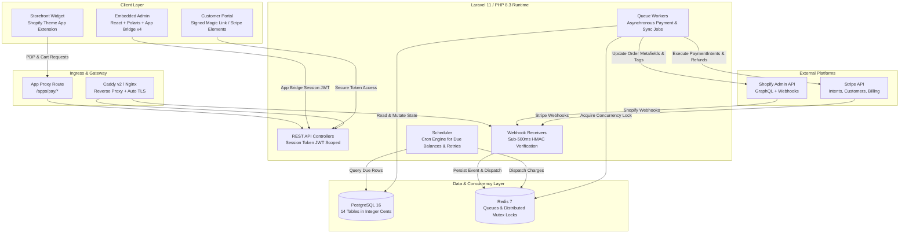
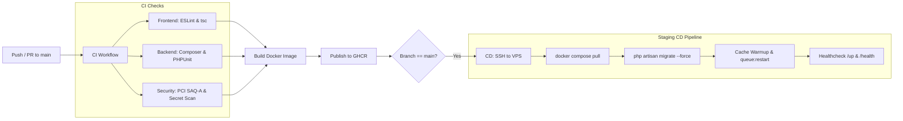

# Northwind Ceramics Custom Payment App

`northline-supply` is a multi-tenant Shopify application integrating Stripe to handle pre-order deposits, automated balance collections, multi-part installments, and recurring club memberships. 

Engineered specifically for bespoke, made-to-order manufacturing workflows with multi-week production lead times, the system eliminates upfront checkout friction for customers while automating balance recovery, webhook reconciliation, and order fulfillment synchronization for merchants.

---

## Table of Contents

- [Business Context & Problem Statement](#business-context--problem-statement)
- [System Architecture](#system-architecture)
- [Technology Stack](#technology-stack)
- [Core Functional Capabilities](#core-functional-capabilities)
- [Engineering & Security Principles](#engineering--security-principles)
- [Database Schema & Data Model](#database-schema--data-model)
- [Repository Organization](#repository-organization)
- [Local Development & Environment Setup](#local-development--environment-setup)
- [Testing & Quality Assurance](#testing--quality-assurance)
- [CI/CD & Deployment Pipeline](#cicd--deployment-pipeline)
- [Observability & Health Checks](#observability--health-checks)
- [Project Status & Roadmap](#project-status--roadmap)

---

## Business Context & Problem Statement

### Client Profile
- **Client**: Emma Carter, Northwind Ceramics (Melbourne, Australia)
- **Business Model**: Handcrafted, made-to-order ceramic pieces sold globally to customers in Australia, the United States, the United Kingdom, and the European Union.
- **Production Lead Times**: 3 to 6 weeks from order placement to kiln firing and final dispatch.

### The Problem
Off-the-shelf e-commerce checkout flows require 100% upfront payment at the time of purchase. For custom ceramics with multi-week lead times, this model introduces two distinct points of failure:
1. **Conversion Loss & Buyer Friction**: High upfront costs for items that will not ship for over a month reduce checkout conversion rates and inflate customer hesitation.
2. **Chargeback & Administrative Burden**: Customers who wait 4–6 weeks for an upfront-paid product frequently open chargebacks or submit cancellation requests during production. Conversely, manual invoicing for final balances before shipping introduces severe administrative overhead, delayed dispatches, and unpaid order backlogs.

### The Solution
A dedicated Shopify payment application integrated with Stripe that:
- Captures an initial deposit (percentage or fixed amount) at checkout.
- Stores customer payment methods off-session with 3D Secure / SCA compliance.
- Automatically schedules and charges remaining balances upon order fulfillment or specified milestone dates.
- Offers multi-part installment schedules and recurring "Ceramic Club" memberships.
- Provides customers with a secure, passwordless portal to update expired payment cards and settle balances.
- Prevents accidental fulfillment of orders with outstanding payment balances via Shopify order tags and metafield synchronization.

---

## System Architecture

The application is structured as a full-stack, containerized system with distinct operational boundaries between storefront interactions, merchant admin tooling, and transactional payment pipelines.



### Architectural Boundaries
1. **Storefront Interaction**: Handled via a Shopify Theme App Extension rendered on Product Detail Pages (PDP) and cart drawers. Zero third-party tracking scripts; bundle budget strictly under 30 KB to protect Core Web Vitals.
2. **Merchant Admin**: Embedded directly inside the Shopify Admin interface using App Bridge v4 and Shopify Polaris components. Authenticated exclusively via short-lived App Bridge Session Tokens (JWT).
3. **Webhook Processing Engine**: Decoupled ingestion and execution. Webhooks return HTTP 200 within 500 ms upon HMAC cryptographic verification, logging payloads into `webhook_events`. Heavy processing, Stripe API calls, and Shopify mutations run asynchronously on Redis worker queues.
4. **Data Isolation & Concurrency**: Multi-tenancy enforced at the database level via `shop_id` scoping on all queries. Distributed atomic locks via Redis (`Cache::lock`) eliminate race conditions and dual-billing hazards across parallel workers.

---

## Technology Stack

| Layer | Technology | Version | Rationale |
|---|---|---|---|
| **Backend Framework** | Laravel | 11.x | Robust native queue workers, task scheduler, AES-256 encrypted model casts, and database migrations. |
| **Backend Runtime** | PHP | 8.3 (Alpine) | Strict type safety, JIT compiler performance, and native BCMath for monetary safety. |
| **Merchant Admin UI** | React / Shopify Polaris | 18.x / Polaris | Native Shopify design language compliance, accessible component library, and App Bridge v4 integration. |
| **Database** | PostgreSQL | 16.x | ACID compliance, JSONB schema support, strict foreign key constraints, and multi-tenant indexing. |
| **Queue & Cache** | Redis | 7.x | Sub-millisecond queue broker, cache driver, and atomic distributed mutex locking (`phpredis`). |
| **Reverse Proxy / TLS** | Caddy | 2.x | Automated Let's Encrypt TLS certificate provisioning and reverse proxy routing. |
| **Payment Gateway** | Stripe API | 2024+ | Global payment methods, SCA/3D Secure compliance, SetupIntents, PaymentIntents, and Stripe Billing. |
| **Platform APIs** | Shopify Admin API | 2027-01 / Stable | GraphQL Admin API, Webhook subscriptions, and App Proxy endpoints. |
| **Containerization** | Docker / Compose | Multi-stage | Reproducible environments across local development, automated CI, and staging/production VPS. |
| **Monitoring** | Sentry / Monolog | Latest | Error tracking with PCI SAQ-A sanitization and structured JSON logs with correlation IDs. |

---

## Core Functional Capabilities

### 1. Split Deposits & Pre-Order Billing
- Merchants designate specific products or collections as deposit-eligible with either percentage terms (e.g., 30%) or fixed amounts (e.g., \$50.00 AUD).
- At checkout, customers pay the initial deposit. The remaining balance is calculated, stored in integer cents, and assigned a future billing date (based on product lead times or scheduled shipping).
- Automatic creation of a Shopify order marked `PARTIALLY_PAID` with identifying line-item tags.

### 2. Scheduled Balance Collection & Dunning
- **Automated Charging**: For customers with saved payment methods (SetupIntents), balances are charged automatically on the due date.
- **Secure Payment Links**: For off-session customers without saved cards, branded email reminders deliver signed, secure balance payment links.
- **Intelligent Dunning Engine**: When a balance payment fails, the system executes an automated retry schedule (Days 1, 3, and 5) before flagging the order for merchant attention without cancelling work already underway.

### 3. Multi-Part Installment Plans
- Flexible installment definitions (e.g., 3 bi-weekly payments or 4 monthly installments).
- Real-time plan calculations displayed on product detail pages through the Theme App Extension.
- Automatic installment sequencing tracked via the `payment_schedules` ledger.

### 4. Recurring "Ceramic Club" Subscriptions
- Manages monthly, quarterly, and annual subscription memberships for studio pieces and pottery clubs.
- Synchronizes renewal charges through Stripe Billing and automatically generates corresponding Shopify fulfillment orders for Emma Carter's studio team upon successful payment.
- Proration engine handles plan upgrades, downgrades, and paused statuses.

### 5. Order Status & Fulfillment Safeguards
- Synchronizes real-time payment states (`pending_deposit`, `deposit_paid`, `balance_due`, `paid`, `payment_failed`, `refunded`) to Shopify orders using order tags and metafields.
- Automatically applies fulfillment holds or warning tags on Shopify orders where production is complete but balances remain unpaid.

### 6. Role-Based Access Control (RBAC)
- **Owner Role (Emma Carter)**: Full administrative authority, including Stripe account credentials, plan creation, refunds, and financial exports.
- **Staff Role (Studio Assistant)**: Operational access to view orders, check payment status, and verify production schedules. Restricted from issuing refunds, deleting plans, or modifying Stripe API keys.

### 7. Passwordless Customer Payment Portal
- Customers authenticate via signed magic links sent to their order email or through Shopify customer account SSO.
- Allows buyers to update expired credit cards, review installment schedules, and settle outstanding balances directly through Stripe-hosted Elements.

---

## Engineering & Security Principles

### 1. Strict PCI SAQ-A Scope
- **Zero Cardholder Data Stored**: The application never ingests, transmits, or stores raw card primary account numbers (PAN), CVVs, or expiration dates.
- All payment inputs are captured using Stripe Elements or hosted Stripe Checkout sessions, maintaining minimal PCI SAQ-A compliance scope.

### 2. Elimination of Floating-Point Rounding Errors
- **Integer Cents Convention**: All financial amounts across the database, internal domain models, API payloads, and webhook handlers are stored and calculated strictly as whole integers in the smallest currency unit (e.g., \$120.50 AUD is stored as `12050`).
- Database columns use PostgreSQL `BIGINT` to prevent precision loss across international currencies (AUD, USD, GBP, EUR).

### 3. Idempotency & Concurrency Defense
- **Stripe Idempotency Keys**: Every payment request sent to Stripe includes a deterministic idempotency key (`order_{id}_schedule_{id}_attempt_{count}`) ensuring network interruptions or re-queued jobs never trigger double charges.
- **Redis Distributed Mutex Locks**: Scheduled charge processors acquire atomic Redis locks (`Cache::lock("charge:schedule:{$id}", 60)`) before initiating payment flows. Concurrent workers attempting the same charge are rejected.
- **Deduplication Ledger**: Inbound webhooks are indexed against `webhook_events.external_id`. Duplicate events delivered by Shopify or Stripe are acknowledged and discarded without reprocessing.

### 4. Cryptographic Security & Secrets Management
- **AES-256 Token Encryption**: Shopify OAuth access tokens and merchant credentials are encrypted at rest using AES-256-CBC via Eloquent encrypted casts (`Shop::$casts['access_token'] = 'encrypted'`).
- **Signature Verification**: Every incoming Shopify webhook is validated against HMAC-SHA256 signatures. Stripe webhooks require cryptographic signing secret verification before payload parsing.
- **Shopify Iframe Security**: Embedded views enforce Content-Security-Policy headers restricting `frame-ancestors` strictly to `https://admin.shopify.com` and the verified merchant domain, while stripping `X-Frame-Options` to prevent clickjacking in embedded contexts.

### 5. Observability & Sanitized Logging
- **Correlation IDs**: `RequestCorrelationIdMiddleware` assigns a unique `X-Request-ID` to every HTTP transaction, propagating the identifier across Monolog logs, API responses, and Sentry breadcrumbs.
- **PII & Credential Scrubbing**: Log formatters and Sentry integrations automatically sanitize sensitive headers (`Authorization`, `X-Shopify-Hmac-Sha256`) and strip credit card patterns and secret tokens prior to writing log records.

---

## Database Schema & Data Model

The persistence layer consists of 14 PostgreSQL tables designed with foreign key constraints, multi-tenant isolation, and explicit indexing.

```
┌─────────────────┐       ┌──────────────────────┐       ┌──────────────────────┐
│      shops      │───┬──<│        users         │       │    plan_targets      │
│ (Tenant Domain, │   │   │(Owner & Staff Roles) │       │(Product/Col. GIDs)   │
│  Encrypted Token│   │   └──────────────────────┘       └──────────┬───────────┘
│  Currency, Stng)│   │                                             │
└────────┬────────┘   ├──<┌──────────────────────┐                  │
         │            │   │        plans         │>─────────────────┘
         │            │   │(Deposit / Installment│
         │            │   │ Subscriptions)       │──┐
         │            │   └──────────────────────┘  │
         │            │                             │    ┌──────────────────────┐
         │            └──<┌──────────────────────┐  ├───<│    subscriptions     │
         │                │      customers       │  │    │(Stripe Sub, Status,  │
         │                │(Shopify/Stripe ID,   │  │    │ Next Renewal Date)   │
         │                │ Default Card PM)     │  │    └──────────────────────┘
         │                └──────────┬───────────┘  │
         │                           │              │
         │                           │              │
         ▼                           ▼              ▼
┌────────────────────────────────────────────────────────┐
│                         orders                         │
│ (Totals in Cents, Currency, 7-State Payment Lifecycle) │
└────────────────────────────┬───────────────────────────┘
                             │
            ┌────────────────┴────────────────┐
            ▼                                 ▼
┌──────────────────────┐          ┌──────────────────────┐
│  payment_schedules   │          │       payments       │
│(Due Date, Balance,   │>─────────│(Stripe PaymentIntent,│
│ Sequence, Attempts)  │          │ Status, Failure Code)│
└──────────────────────┘          └──────────┬───────────┘
                                             │
                                             ▼
                                  ┌──────────────────────┐
                                  │       refunds        │
                                  │(Stripe & Shopify IDs,│
                                  │ Amount, Reason, User)│
                                  └──────────────────────┘
```

### Table Dictionary

| Table | Purpose | Primary Constraints & Multi-Tenancy |
|---|---|---|
| `shops` | App installation record, store domain, AES-256 access token, Stripe ID. | `shopify_domain` UNIQUE, PK `id`. |
| `users` | Authenticated merchants and studio staff. Enforces `owner` vs `staff` role. | FK `shop_id` -> `shops.id`. |
| `plans` | Configuration for deposits (percentage/cents), installments, and subscriptions. | FK `shop_id` -> `shops.id`. |
| `plan_targets` | Associative table linking plans to Shopify product or collection GIDs. | FK `plan_id` -> `plans.id` (CASCADE). |
| `customers` | Maps Shopify customer entities to Stripe Customer IDs and default payment methods. | FK `shop_id` -> `shops.id`. |
| `orders` | Master orders storing total amounts, captured amounts, currency, and payment status. | FK `shop_id`, FK `customer_id`, FK `plan_id`. |
| `payment_schedules` | Ledger of future installment amounts, due dates, retry states, and sequence order. | FK `order_id` -> `orders.id` (CASCADE). |
| `payments` | Immutable transaction log of captured Stripe PaymentIntents. | FK `order_id`, FK `schedule_id`. |
| `subscriptions` | Recurring membership states, renewal dates, and Stripe subscription bindings. | FK `shop_id`, `stripe_subscription_id` UNIQUE. |
| `refunds` | Reversal audit log tracking Stripe and Shopify refund IDs and initiating user. | FK `payment_id`, FK `created_by` -> `users.id`. |
| `webhook_events` | Idempotent ledger storing raw inbound Stripe and Shopify webhook payloads. | `external_id` UNIQUE, status index. |
| `email_templates` | Configurable transactional notifications (reminders, deposit confirmations). | FK `shop_id` -> `shops.id`. |
| `email_logs` | Delivery and dispatch records for transactional customer notifications. | FK `order_id` -> `orders.id`. |
| `audit_logs` | Security log recording financial operations, refund actions, and credential changes. | FK `shop_id`, FK `user_id`. |

---

## Repository Organization

```
northline-supply/
├── .github/
│   ├── workflows/
│   │   ├── ci.yml                 # Automated testing, linting, typechecking & security scans
│   │   └── deploy-staging.yml     # Zero-downtime SSH automated staging deployment
│   └── pull_request_template.md   # 7-point Definition of Done checklist
├── app/
│   ├── Http/
│   │   ├── Controllers/
│   │   │   ├── Admin/             # Embedded Polaris admin controllers
│   │   │   ├── Api/               # Session token authenticated internal APIs
│   │   │   ├── Auth/              # Shopify OAuth install & callback controllers
│   │   │   └── Webhooks/          # Cryptographic HMAC verification & webhook intake
│   │   └── Middleware/            # Correlation ID, Session Token verification, CSP frame headers
│   ├── Models/                    # Eloquent models with AES-256 casts and multi-tenant scopes
│   └── Services/
│       └── Shopify/               # Shopify OAuth, GraphQL Admin API & metadata services
├── config/                        # Laravel environment, logging, and security configurations
├── database/
│   └── migrations/                # Database migrations (PostgreSQL integer cents schema)
├── docker/
│   ├── Caddyfile                  # Staging Caddy reverse proxy configuration
│   ├── nginx.conf                 # Containerized Nginx HTTP routing
│   └── supervisord.conf           # Process supervision for PHP-FPM, Nginx, and workers
├── resources/
│   └── views/
│       └── app.blade.php          # App Bridge v4 embedded Polaris entry view
├── routes/
│   ├── api.php                    # Authenticated admin & proxy endpoints
│   └── web.php                    # Embedded admin shell, OAuth routes & webhook endpoints
├── scripts/
│   ├── deploy-staging.sh          # VPS zero-downtime deployment script
│   ├── stack.ps1                  # Cross-platform PowerShell container manager
│   ├── stripe-listen.ps1          # Stripe CLI webhook listener shortcut
│   └── sync-kanban.js             # Notion Kanban & Obsidian memory synchronization
├── tests/
│   └── Feature/                   # Feature test suite (OAuth, Migrations, Admin Shell, Health)
├── Vault/
│   └── Northline Supply Vault/    # Authoritative Obsidian living specification repository
├── Dockerfile                     # Streamlined production container build (PHP 8.3 + Nginx + Redis + PgSQL)
├── Makefile                       # Developer CLI targets (pure Docker)
└── shopify.app.toml               # Shopify App CLI configuration & access scopes
```

---

## Local Development & Environment Setup

### Prerequisites
- [Docker](https://www.docker.com/) (pure container runner, no compose needed)
- [Node.js](https://nodejs.org/) v22+ and npm
- [Stripe CLI](https://stripe.com/docs/stripe-cli) (for local webhook testing)
- [Shopify CLI](https://shopify.dev/docs/apps/tools/cli) (for partner development stores)

### Quick Start (Automated Docker Stack)

1. **Clone the repository and enter the directory**:
   ```bash
   git clone https://github.com/your-org/northline-supply.git
   cd northline-supply
   ```

2. **Initialize the local environment**:
   Using `make` (macOS / Linux / WSL):
   ```bash
   make setup
   ```
   Or using PowerShell (Windows native):
   ```powershell
   .\scripts\stack.ps1 setup
   ```
   *This command automatically copies `.env.example` to `.env`, builds the multi-stage Docker image, boots containers, installs Composer dependencies, generates the application encryption key, and executes PostgreSQL migrations.*

3. **Configure Environment Secrets**:
   Edit `.env` with your Shopify Partner and Stripe test credentials:
   ```env
   # Shopify Partner Dashboard Credentials
   SHOPIFY_API_KEY=your_shopify_api_key
   SHOPIFY_API_SECRET=your_shopify_api_secret
   SHOPIFY_DEV_STORE=your-store.myshopify.com

   # Stripe Test Mode Credentials (AUD)
   STRIPE_KEY=pk_test_your_key
   STRIPE_SECRET=sk_test_your_secret
   STRIPE_WEBHOOK_SECRET=whsec_your_signing_secret
   ```

4. **Verify Application Health**:
   The web application is exposed at `http://localhost:8000`. Verify the operational health check:
   ```bash
   curl -s http://localhost:8000/health
   ```
   Expected response:
   ```json
   {
     "status": "ok",
     "app": "Northwind Ceramics Payment App",
     "services": {
       "database": { "connection": "pgsql", "status": "connected" },
       "redis": { "status": "connected" },
       "queue": { "connection": "redis", "status": "healthy", "threshold": 100 }
     }
   }
   ```

5. **Forward Stripe Webhooks to Local Stack**:
   In a separate terminal, forward live Stripe test events into the Docker webhook listener:
   ```bash
   npm run stripe:listen
   ```

---

## Testing & Quality Assurance

The codebase enforces automated testing, static analysis, and security verification on all changes.

### Running Test Suites
Run the PHPUnit feature test suite inside the Docker container:
```bash
make test
```
Or via npm / PowerShell:
```powershell
npm run stack:test
```

### Static Analysis & Type Checking
```bash
# Frontend ESLint verification
npm run lint

# TypeScript compile validation without emit
npm run typecheck
```

### Automated Test Coverage
- **OAuth Installation Pipeline** ([`ShopifyInstallFlowTest.php`](file:///c:/codework/northline-supply/tests/Feature/ShopifyInstallFlowTest.php)): Validates HMAC signatures, OAuth nonces, AES-256 token encryption at rest, and soft-deactivation on `app/uninstalled` webhooks.
- **Embedded Admin Shell & Security** ([`EmbeddedAdminShellTest.php`](file:///c:/codework/northline-supply/tests/Feature/EmbeddedAdminShellTest.php)): Validates App Bridge v4 session token JWT decoding, expiration checks, CSP `frame-ancestors` enforcement, and domain validation.
- **Database Schema & Constraints** ([`CoreMigrationsTest.php`](file:///c:/codework/northline-supply/tests/Feature/CoreMigrationsTest.php)): Validates PostgreSQL table creation, foreign key cascading, and integer cent storage representations.
- **Health & Security Sanitization** ([`HealthCheckTest.php`](file:///c:/codework/northline-supply/tests/Feature/HealthCheckTest.php)): Validates database/Redis connectivity checks, correlation ID preservation, and Sentry PII/card scrubbing filters.

---

## CI/CD & Deployment Pipeline

Every commit and pull request is validated through an automated GitHub Actions pipeline.



### Continuous Integration (`ci.yml`)
1. **Frontend Gate**: Node.js 22 environment runs ESLint and TypeScript type checking.
2. **Backend Gate**: PHP 8.3 environment runs `composer validate`, prepares test databases, and executes PHPUnit test suites.
3. **Security Gate**: Performs regex scans against the repository tree to block accidental commitments of raw card numbers (PANs) or unencrypted live credentials.
4. **Containerization**: Multi-stage Docker build verified using Docker Buildx cache, tagging images with Git commit SHAs and `latest`.

### Continuous Deployment (`deploy-staging.yml`)
- Triggered automatically on merge to `main`.
- Connects securely to the staging server via SSH.
- Executes zero-downtime rolling deployment: pulls updated images, applies database migrations (`migrate --force`), warms configuration/route caches, restarts Redis queue workers, and verifies HTTP 200 on the `/health` endpoint before completing.

---

## Observability & Health Checks

### Health Check Endpoint (`GET /health`)
Monitors infrastructure subsystems in real-time, providing immediate diagnostics for Uptime Kuma and orchestrator liveness probes:
- **Database**: Validates active PDO query execution against PostgreSQL.
- **Redis**: Verifies connection responsiveness via Redis `PING`.
- **Queue Backlog**: Inspects the Redis job queue backlog and raises alerts if queued jobs exceed configurable thresholds (`QUEUE_BACKLOG_THRESHOLD`).

### Request Correlation & Logging
- Every request passing through the system is assigned or preserves an `X-Request-ID` header via `RequestCorrelationIdMiddleware`.
- The correlation ID is automatically injected into Monolog JSON structured log context, allowing engineers to trace end-to-end execution paths across HTTP requests, background jobs, and third-party webhook dispatches.
- Sensitive payment fields and authentication tokens are filtered out prior to logging.

---

## Project Status & Roadmap

The project is actively developed following a 6-sprint implementation schedule (50 developer days) tracked live on our Obsidian living specification repository and Notion Kanban board.

```
Sprint 0: Infrastructure & Foundations     [COMPLETED]
Sprint 1: Core Billing & Merchant Admin    [IN PROGRESS]
Sprint 2: Storefront Widget & App Proxy    [PLANNED]
Sprint 3: Webhook Pipeline & Auto Balance  [PLANNED]
Sprint 4: Subscriptions & Customer Portal  [PLANNED]
Sprint 5: Hardening, Polish & Go-Live      [PLANNED]
```

### Deliverables Completed
- [x] Multi-stage Docker topology (Laravel 11, Worker, Scheduler, PostgreSQL 16, Redis 7).
- [x] Automated CI/CD pipeline with GitHub Actions, Caddy v2 TLS reverse proxy, and zero-downtime VPS deployment.
- [x] Core PostgreSQL multi-tenant schema with integer cent representations across all financial models (`S1-T1`).
- [x] Shopify OAuth installation pipeline with AES-256 encrypted access tokens and `app/uninstalled` soft-deactivation (`S1-T2`).
- [x] Structured JSON logging, correlation ID tracing (`X-Request-ID`), and PCI SAQ-A Sentry sanitization (`S0-T6`).
- [x] Operational health check subsystem (`/health`) with Uptime Kuma integration (`S0-T6`).
- [x] Embedded Admin Shell with App Bridge v4, session token JWT verification, and strict CSP frame protection (`S1-T3`).

### Next Immediate Milestones
- [ ] Connect merchant Stripe account via Stripe Connect OAuth / restricted keys (`S1-T4`).
- [ ] Build deposit plan builder UI with Polaris and plan assignment engine (`S1-T5`).
- [ ] Implement lightweight storefront PDP theme app extension widget (< 30 KB) (`S2-T1`).
- [ ] Establish Shopify App Proxy checkout routing (`/apps/pay/*`) (`S2-T2`).

---

## Developer Documentation & References

- **Architecture Decision Records**: Detailed technical decisions are recorded in `Vault/Northline Supply Vault/03 - Decisions/` (e.g., `ADR_002_CHECKOUT_STRATEGY.md`, `ADR_003_LARAVEL_DOCKER_STACK.md`).
- **Living Specifications**: Product requirements (PRD), technical specifications (TRD), and ERD diagrams are maintained in `Vault/Northline Supply Vault/11 - Specs/`.
- **Engineering Guidelines**: Developer conventions, Definition of Done, and agent execution policies are defined in [`AGENTS.md`](file:///c:/codework/northline-supply/AGENTS.md).
