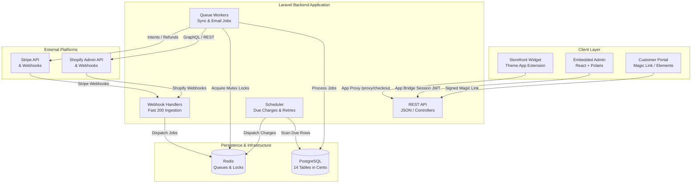

# System Architecture: Northwind Ceramics Payment App

## Architectural Overview
Northwind Ceramics Payment App is built as a single monolithic Laravel 11 application powering an embedded React + Polaris merchant dashboard, a storefront theme app extension, and a customer self-service portal, backed by PostgreSQL and Redis.

## Layer Responsibilities
1. **REST API**: Serves the Polaris embedded admin and customer portal. Every request is strictly scoped to one shop (`shop_id`).
2. **Webhook Handlers**: Cryptographically verify signatures (Shopify HMAC / Stripe signing secret), persist raw payloads immediately to `webhook_events`, and respond HTTP 200 in under 1 second (< 500 ms target). Heavy processing is dispatched to Redis queues.
3. **Queue Workers**: Asynchronously process webhook events, call Stripe and Shopify APIs with idempotency keys, and dispatch transactional notification emails.
4. **Scheduler**: Runs every minute/few minutes to find scheduled charges due today, expiring balance links, and dunning retry candidates.
5. **PostgreSQL**: Primary transactional datastore. All monetary values are represented as integer cents (`BIGINT`) to avoid floating-point discrepancies. Multi-tenant scoping enforced via `shop_id`.
6. **Redis**: Manages job queues and distributed concurrency locks (`Cache::lock`), ensuring dual workers never double-charge the same `payment_schedules` row.

## Technology Stack Rationale
| Component | Selection | Rationale |
|---|---|---|
| **Backend** | Laravel 11, PHP 8.3 | Native robust queues, scheduler, validation, encryption, and Eloquent ORM built-in. |
| **Frontend** | React with Shopify Polaris | Matches Shopify Admin native design guidelines (NFR-16). |
| **Database** | PostgreSQL | Strong ACID transactions, JSONB columns, strict foreign key constraints. |
| **Queue & Cache** | Redis | High throughput, sub-millisecond job broker, atomic distributed locks. |
| **Payments** | Stripe API | Handles 3D Secure, SetupIntents (saved payment methods), PaymentIntents, and Checkout. |
| **Email** | Postmark or Amazon SES | High deliverability for critical transactional and billing emails. |
| **Hosting & CI/CD**| Docker, GitHub Actions, VPS | Containerized reproducible deployments and automated testing. |
| **Monitoring** | Sentry, Uptime Kuma | Real-time error tracking and uptime/queue health alerting. |

## Related Specs
- TRD: [[TRD]]
- Database Schema: [[DATABASE_SCHEMA]]
- Checkout Strategy: [[ADR_002_CHECKOUT_STRATEGY]]
