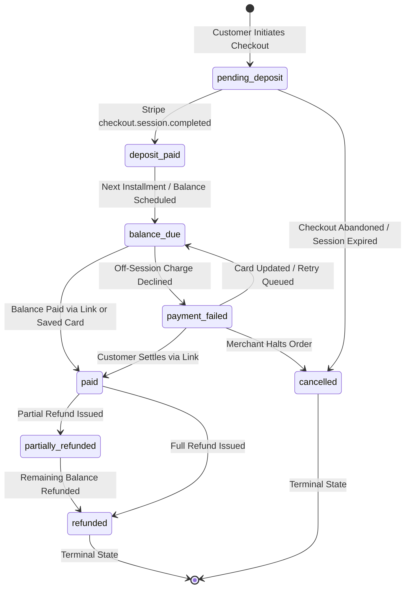

# Application Flow: Northwind Ceramics Payment App

## 1. Entry Points & User Personas
- **Merchant Owner (Emma Carter)**: Opens app inside Shopify Admin. Full permissions for onboarding, Stripe configuration, plan management, refunds, and financial reporting.
- **Merchant Staff (Studio Assistant)**: Opens app inside Shopify Admin. Can view orders, check payment status, and trigger manual balance reminders; forbidden from issuing refunds or changing Stripe settings.
- **Customer**: Browses made-to-order pottery on Shopify storefront, pays deposit at checkout, receives balance email reminders, pays via secure links, or manages subscriptions via the portal.
- **System**: Background workers and cron scheduler executing scheduled charges, retries, and webhook synchronizations.

## 2. Screen Inventory
| Screen ID | Screen Name | Route / Context | Access | Purpose |
|---|---|---|---|---|
| **SCR-001** | App Navigation Shell | `/app` | Owner, Staff | Shopify App Bridge container, navigation tabs, title bar |
| **SCR-002** | Setup Checklist | `/app` (Onboarding state) | Owner | Checklist: Connect Stripe → Create plan → Turn on widget |
| **SCR-003** | Stripe Settings | `/app/settings/stripe` | Owner | Stripe Connect / API key configuration and live connection status |
| **SCR-004** | Payment Plans List | `/app/plans` | Owner, Staff | Overview of active deposit, installment, and subscription plans |
| **SCR-005** | Plan Builder Form | `/app/plans/new`, `/app/plans/:id` | Owner | Configure percentage/fixed deposit, installments, and targets |
| **SCR-006** | Orders & Payments Table| `/app/orders` | Owner, Staff | Searchable, filterable list of orders by payment status |
| **SCR-007** | Order Detail & Schedule | `/app/orders/:id` | Owner, Staff | Displays paid deposit, remaining balance due date, and history |
| **SCR-008** | Refund Modal | `/app/orders/:id` (Modal) | Owner | Issue full or partial refund to Stripe and Shopify |
| **SCR-009** | Financial Dashboard | `/app/dashboard` | Owner, Staff | KPI metrics: cash collected, balances due, upcoming charges |
| **SCR-010** | Storefront PDP Widget | Product Detail Page (Storefront)| Public Customer | Shows deposit vs full price, selects payment mode |
| **SCR-011** | Hosted Balance Page | `/pay/balance/:token` | Public Customer | Secure payment page for settling remaining order balance |
| **SCR-012** | Customer Portal | `/portal` | Authenticated Customer| Passwordless portal to view schedules and update payment cards |

## 3. Order Payment Status Lifecycle

### State Transition Matrix
| From State | Trigger Event | Next State | System Actions |
|---|---|---|---|
| `pending_deposit` | Stripe confirms deposit payment | `deposit_paid` | Create Shopify order, tag `deposit-paid`, save customer card |
| `pending_deposit` | Session expires or fails | `cancelled` | Mark order record cancelled |
| `deposit_paid` | Balance row created in schedule | `balance_due` | Tag Shopify order `balance-due`, set metafield with due date |
| `balance_due` | Balance charged or paid via link | `paid` | Tag order `paid`, lift fulfillment hold warning, email receipt |
| `balance_due` | Scheduled charge fails | `payment_failed` | Tag order `payment-failed`, email customer card update link |
| `payment_failed` | Retry succeeds or card updated | `paid` / `balance_due` | Update schedule, restore order tags |
| `payment_failed` | 3 retries fail, manual cancel | `cancelled` | Merchant stops production, tags order `cancelled` |
| `paid` | Full refund processed | `refunded` | Issue Stripe refund, create Shopify refund, tag order `refunded` |
| `paid` | Partial refund processed | `partially_refunded` | Issue partial refund, update balances, tag `partially-refunded` |

## 4. Main Payment Flows

### Flow A: Deposit and Balance Collection (Option B)
1. **Product Selection**: Customer chooses the deposit option on the storefront product page. The widget displays the deposit amount and balance due.
2. **Checkout Initiation**: The storefront widget calls `/proxy/checkout`. The app creates a Stripe Checkout session that takes the deposit and saves the card credentials for future off-session billing (`setup_future_usage: 'off_session'`).
3. **Webhook Ingestion**: Customer completes payment. Stripe dispatches `checkout.session.completed`. The webhook handler verifies the signature, persists the event, returns HTTP 200, and queues `ProcessDepositJob`.
4. **Order Provisioning**: The worker creates the Shopify order, assigns payment tags (`deposit-paid`, `balance-due`), populates metafields, and writes the `payment_schedules` row for the balance.
5. **Confirmation Email**: The worker sends the customer a branded "Deposit Confirmed" email detailing the schedule.
6. **Balance Reminder**: The scheduler runs daily, identifies balances due in 7 days, and dispatches a reminder email containing a secure, expiring payment link.
7. **Final Settlement**: The customer pays via the link (or the saved card is charged on schedule). Stripe fires `payment_intent.succeeded`. The order moves to `paid`, tags update, and the merchant is notified.

### Flow B: Failed Payment & Retry Sequence (Phase 2)
1. **Failure Notification**: Stripe sends `payment_intent.payment_failed` during an automated off-session charge attempt.
2. **Status Update**: The order transitions to `payment_failed`. The app sends an automated notification to the customer with a secure link to update their payment method.
3. **Automated Dunning**: The scheduler retries the charge on day 1, day 3, and day 5.
4. **Resolution or Escalation**: If a retry succeeds, the order returns to good standing. If all retries fail, the order is flagged in Emma's dashboard for attention with an alert (no automatic cancellation).

### Flow C: Refund Flow
1. **Initiation**: Merchant selects the order in the embedded admin and inputs the refund amount and reason.
2. **Dual-System Execution**: The app calls the Stripe Refund API to return the funds, then creates the corresponding refund record on the Shopify order.
3. **Audit Trail**: Both refund IDs (`stripe_refund_id`, `shopify_refund_id`) are linked and stored in the database, and an immutable entry is added to `audit_logs`.

## Change Log
| Date | Change | Old → New | Reason |
|---|---|---|---|
| 2026-10-11 | Application flow baseline | Scaffold flow → Northwind Ceramics v1.0 | Full specification ingestion from client document |
