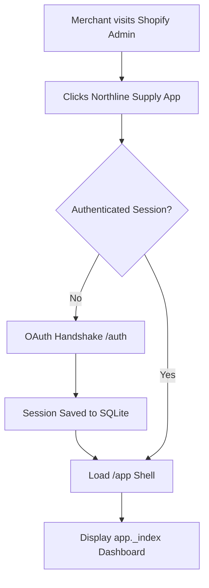

# Application Flow

## 1. Entry Points & Roles
- Merchant User: Accesses application via Shopify Admin App navigation.
- System / Webhook: Ingests automated platform lifecycle events.

## 2. Screen Inventory
| Screen ID | Name | Route | Access (role) | Purpose |
|-----------|------|-------|---------------|---------|
| SCR-001 | App Root Layout | `/app` | Merchant | App Bridge initialization, navigation bar |
| SCR-002 | Home Dashboard | `/app` (`app._index.jsx`) | Merchant | Welcome overview, product generation trigger |
| SCR-003 | Additional Page | `/app/additional` (`app.additional.jsx`) | Merchant | Secondary view and documentation links |
| SCR-004 | Login / Auth | `/auth/login` | Merchant | Fallback OAuth initiation screen |

## 3. Primary Flows
### Flow: Merchant Onboarding & App Launch

## 4. Decision Points & Branching Paths
- Authenticated vs Unauthenticated: Authenticated sessions proceed to embedded routes; missing or expired sessions redirect to OAuth flow.

## 5. Error, Empty, and Edge-Case States
- OAuth Denied / Expired: Prompts re-authentication modal via App Bridge.
- Disconnected Tunnel / Dev Server: Standard local network error banner.

## 6. Navigation Map
- `/app` (Home) ↔ `/app/additional` (Additional Page).

## 7. Role-Based Differences
- Single Merchant Admin role currently supported within Shopify Admin scope.

## Change Log
| Date | Change | Old → New | Reason |
|------|--------|-----------|--------|
| 2026-10-11 | Initial baseline spec | None → v1.0 | Project initialization from scaffold |
