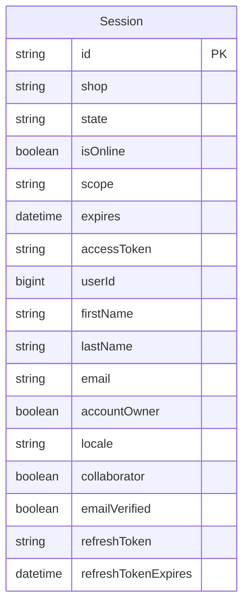

# Database Schema

## 1. Overview
- Database engine: SQLite (`prisma/dev.sqlite`).
- ORM: Prisma Client (`@prisma/client`).
- Primary Key Strategy: UUID string (`cuid` / Shopify session ID).
- Timestamp Strategy: ISO-8601 DateTime.

## 2. Entity Relationship Diagram

## 3. Tables

### Session
| Column | Type | Null | Default | Key | Notes |
|--------|------|------|---------|-----|-------|
| `id` | String | No | - | PK | Shopify Session ID |
| `shop` | String | No | - | - | Store domain (e.g. `example.myshopify.com`) |
| `state` | String | No | - | - | OAuth nonce state |
| `isOnline` | Boolean | No | `false` | - | Online vs Offline token flag |
| `scope` | String | Yes | - | - | Granted access scopes |
| `expires` | DateTime | Yes | - | - | Expiration timestamp |
| `accessToken` | String | No | - | - | Shopify GraphQL access token |
| `userId` | BigInt | Yes | - | - | User ID for online sessions |
| `firstName` | String | Yes | - | - | User first name |
| `lastName` | String | Yes | - | - | User last name |
| `email` | String | Yes | - | - | User email |
| `accountOwner` | Boolean | No | `false` | - | Shop owner flag |
| `locale` | String | Yes | - | - | Merchant locale preference |
| `collaborator` | Boolean | Yes | `false` | - | Collaborator account flag |
| `emailVerified` | Boolean | Yes | `false` | - | Verification flag |
| `refreshToken` | String | Yes | - | - | Token rotation refresh token |
| `refreshTokenExpires` | DateTime | Yes | - | - | Refresh expiration timestamp |

- Primary key: `id`
- Foreign keys: None (managed by Shopify OAuth storage adapter)
- Indexes: Primary key index on `id`

## 4. Relationships
- Standalone session storage table managed by `@shopify/shopify-app-session-storage-prisma`.

## 5. Business Rules Enforced at Data Level
- Every active session must have a non-null `accessToken` and `shop`.

## 6. Migration History (summary only)
- `2024..._init`: Initial Prisma migration creating the `Session` table.

## 7. Seed / Reference Data
- None (sessions generated dynamically via OAuth handshake).

## Change Log
| Date | Change | Old → New | Reason |
|------|--------|-----------|--------|
| 2026-10-11 | Initial baseline spec | None → v1.0 | Project initialization from scaffold |
