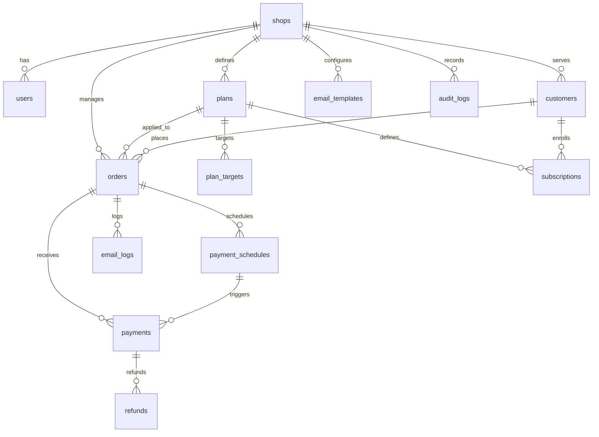

# Database Schema: Northwind Ceramics Payment App

## 1. Overview
- **Database Engine**: PostgreSQL 16+.
- **Monetary Unit Strategy**: All financial values are stored as integers in the smallest currency unit (cents/pence) to prevent floating-point calculation errors.
- **Multi-Tenancy Strategy**: Every entity carries a foreign key `shop_id` referencing `shops.id`. All database queries are scoped by `shop_id`.
- **Timestamp Strategy**: ISO-8601 timestamps (`created_at`, `updated_at`) on every table.

## 2. Entity Relationship Diagram

## 3. Detailed Table Definitions (14 Tables)

### 1. `shops`
One row per app installation.
| Column | Type | Nullable | Default | Constraints | Description |
|---|---|---|---|---|---|
| `id` | BIGINT | No | AUTO_INCREMENT | PK | Unique shop identifier |
| `shopify_domain` | VARCHAR(255) | No | - | UNIQUE | Store domain (e.g. `northwind-ceramics.myshopify.com`) |
| `access_token` | TEXT | No | - | - | Encrypted Shopify Admin API access token (AES-256) |
| `stripe_account_id` | VARCHAR(255) | Yes | NULL | - | Connected Stripe Account ID or API identifier |
| `currency` | VARCHAR(3) | No | 'AUD' | - | Default currency (AUD, USD, GBP, EUR) |
| `settings` | JSONB | No | '{}' | - | Store preferences, grace periods, dunning config |
| `installed_at` | TIMESTAMP | Yes | NULL | - | App installation timestamp |
| `uninstalled_at` | TIMESTAMP | Yes | NULL | - | App uninstallation timestamp |
| `created_at` | TIMESTAMP | No | NOW() | - | Creation timestamp |
| `updated_at` | TIMESTAMP | No | NOW() | - | Update timestamp |

### 2. `users`
Admin and staff logins for the embedded admin.
| Column | Type | Nullable | Default | Constraints | Description |
|---|---|---|---|---|---|
| `id` | BIGINT | No | AUTO_INCREMENT | PK | User ID |
| `shop_id` | BIGINT | No | - | FK -> `shops.id` | Shop reference |
| `email` | VARCHAR(255) | No | - | - | User email |
| `role` | VARCHAR(20) | No | 'owner' | - | Role: `owner` (full access) or `staff` (no refunds/Stripe) |
| `created_at` | TIMESTAMP | No | NOW() | - | Creation timestamp |
| `updated_at` | TIMESTAMP | No | NOW() | - | Update timestamp |

### 3. `plans`
Payment plan configurations covering deposits, installments, and subscriptions.
| Column | Type | Nullable | Default | Constraints | Description |
|---|---|---|---|---|---|
| `id` | BIGINT | No | AUTO_INCREMENT | PK | Plan ID |
| `shop_id` | BIGINT | No | - | FK -> `shops.id` | Shop reference |
| `name` | VARCHAR(255) | No | - | - | Plan name (e.g. "30% Made-to-Order Deposit") |
| `type` | VARCHAR(30) | No | - | - | `deposit`, `installment`, `subscription` |
| `deposit_type` | VARCHAR(20) | Yes | NULL | - | `percentage` or `fixed` (NULL for subscriptions) |
| `deposit_value` | INTEGER | Yes | NULL | - | Percentage (e.g. 30) or fixed cents (e.g. 5000 = $50.00) |
| `installments_count` | INTEGER | No | 1 | - | Number of installments |
| `interval` | VARCHAR(20) | Yes | NULL | - | `day`, `week`, `month`, `year` |
| `interval_count` | INTEGER | No | 1 | - | Frequency interval count |
| `active` | BOOLEAN | No | true | - | Whether plan is currently active |
| `created_at` | TIMESTAMP | No | NOW() | - | Creation timestamp |
| `updated_at` | TIMESTAMP | No | NOW() | - | Update timestamp |

### 4. `plan_targets`
Associations linking plans to specific products or collections.
| Column | Type | Nullable | Default | Constraints | Description |
|---|---|---|---|---|---|
| `id` | BIGINT | No | AUTO_INCREMENT | PK | Target ID |
| `plan_id` | BIGINT | No | - | FK -> `plans.id` | Plan reference (CASCADE) |
| `shopify_product_id` | VARCHAR(255) | Yes | NULL | - | Shopify Product GID |
| `shopify_collection_id` | VARCHAR(255) | Yes | NULL | - | Shopify Collection GID |
| `created_at` | TIMESTAMP | No | NOW() | - | Creation timestamp |
| `updated_at` | TIMESTAMP | No | NOW() | - | Update timestamp |

### 5. `customers`
Customer records linking Shopify customers to Stripe customer profiles and saved cards.
| Column | Type | Nullable | Default | Constraints | Description |
|---|---|---|---|---|---|
| `id` | BIGINT | No | AUTO_INCREMENT | PK | Internal customer ID |
| `shop_id` | BIGINT | No | - | FK -> `shops.id` | Shop reference |
| `shopify_customer_id` | VARCHAR(255) | Yes | NULL | - | Shopify Customer GID |
| `email` | VARCHAR(255) | No | - | - | Customer email address |
| `stripe_customer_id` | VARCHAR(255) | No | - | - | Stripe Customer ID (`cus_...`) |
| `default_payment_method` | VARCHAR(255) | Yes | NULL | - | Stored Stripe Payment Method token (`pm_...`) |
| `created_at` | TIMESTAMP | No | NOW() | - | Creation timestamp |
| `updated_at` | TIMESTAMP | No | NOW() | - | Update timestamp |

### 6. `orders`
Master order record storing totals and aggregate payment lifecycle status.
| Column | Type | Nullable | Default | Constraints | Description |
|---|---|---|---|---|---|
| `id` | BIGINT | No | AUTO_INCREMENT | PK | Order ID |
| `shop_id` | BIGINT | No | - | FK -> `shops.id` | Shop reference |
| `shopify_order_id` | VARCHAR(255) | Yes | NULL | - | Shopify Order GID |
| `customer_id` | BIGINT | No | - | FK -> `customers.id` | Customer reference |
| `plan_id` | BIGINT | No | - | FK -> `plans.id` | Plan reference |
| `currency` | VARCHAR(3) | No | 'AUD' | - | Currency code (AUD, USD, GBP, EUR) |
| `total_amount` | BIGINT | No | - | - | Total order amount in integer cents |
| `paid_amount` | BIGINT | No | 0 | - | Total captured amount in integer cents |
| `payment_status` | VARCHAR(30) | No | 'pending_deposit'| - | 7-state status (e.g. `deposit_paid`, `balance_due`, `paid`) |
| `created_at` | TIMESTAMP | No | NOW() | - | Creation timestamp |
| `updated_at` | TIMESTAMP | No | NOW() | - | Update timestamp |

### 7. `payment_schedules`
Individual planned future charges or balances.
| Column | Type | Nullable | Default | Constraints | Description |
|---|---|---|---|---|---|
| `id` | BIGINT | No | AUTO_INCREMENT | PK | Schedule ID |
| `order_id` | BIGINT | No | - | FK -> `orders.id` | Order reference (CASCADE) |
| `sequence` | INTEGER | No | 1 | - | Payment sequence index (1, 2, 3...) |
| `due_at` | TIMESTAMP | No | - | - | Scheduled billing date |
| `amount` | BIGINT | No | - | - | Amount due in integer cents |
| `status` | VARCHAR(30) | No | 'pending' | - | `pending`, `processing`, `succeeded`, `failed`, `cancelled` |
| `attempt_count` | INTEGER | No | 0 | - | Number of charge attempts |
| `next_retry_at` | TIMESTAMP | Yes | NULL | - | Next retry timestamp |
| `stripe_payment_intent_id`| VARCHAR(255) | Yes | NULL | - | Associated Stripe PaymentIntent ID |
| `created_at` | TIMESTAMP | No | NOW() | - | Creation timestamp |
| `updated_at` | TIMESTAMP | No | NOW() | - | Update timestamp |

### 8. `payments`
Real charge attempts executed via Stripe.
| Column | Type | Nullable | Default | Constraints | Description |
|---|---|---|---|---|---|
| `id` | BIGINT | No | AUTO_INCREMENT | PK | Payment ID |
| `order_id` | BIGINT | No | - | FK -> `orders.id` | Order reference (CASCADE) |
| `schedule_id` | BIGINT | Yes | NULL | FK -> `payment_schedules.id` | Associated schedule row |
| `stripe_payment_intent_id`| VARCHAR(255) | No | - | - | Stripe PaymentIntent ID (`pi_...`) |
| `amount` | BIGINT | No | - | - | Captured amount in integer cents |
| `status` | VARCHAR(30) | No | - | - | `succeeded`, `failed`, `requires_action` |
| `failure_code` | VARCHAR(255) | Yes | NULL | - | Stripe error or decline code |
| `created_at` | TIMESTAMP | No | NOW() | - | Creation timestamp |
| `updated_at` | TIMESTAMP | No | NOW() | - | Update timestamp |

### 9. `subscriptions` (Phase 2)
Ceramic Club recurring membership subscriptions.
| Column | Type | Nullable | Default | Constraints | Description |
|---|---|---|---|---|---|
| `id` | BIGINT | No | AUTO_INCREMENT | PK | Subscription ID |
| `shop_id` | BIGINT | No | - | FK -> `shops.id` | Shop reference |
| `customer_id` | BIGINT | No | - | FK -> `customers.id` | Customer reference |
| `plan_id` | BIGINT | No | - | FK -> `plans.id` | Plan reference |
| `stripe_subscription_id` | VARCHAR(255) | No | - | UNIQUE | Stripe Subscription ID (`sub_...`) |
| `status` | VARCHAR(30) | No | 'active' | - | `active`, `past_due`, `paused`, `cancelled` |
| `next_renewal_at` | TIMESTAMP | No | - | - | Next billing date |
| `paused_until` | TIMESTAMP | Yes | NULL | - | Resumption date if paused |
| `created_at` | TIMESTAMP | No | NOW() | - | Creation timestamp |
| `updated_at` | TIMESTAMP | No | NOW() | - | Update timestamp |

### 10. `refunds`
Reversals linked synchronously between Stripe and Shopify.
| Column | Type | Nullable | Default | Constraints | Description |
|---|---|---|---|---|---|
| `id` | BIGINT | No | AUTO_INCREMENT | PK | Refund ID |
| `payment_id` | BIGINT | No | - | FK -> `payments.id` | Payment reference |
| `stripe_refund_id` | VARCHAR(255) | No | - | - | Stripe Refund ID (`re_...`) |
| `shopify_refund_id` | VARCHAR(255) | Yes | NULL | - | Shopify Refund GID |
| `amount` | BIGINT | No | - | - | Refunded amount in integer cents |
| `reason` | TEXT | Yes | NULL | - | Refund reason |
| `created_by` | BIGINT | Yes | NULL | FK -> `users.id` | Merchant user who initiated refund |
| `created_at` | TIMESTAMP | No | NOW() | - | Creation timestamp |
| `updated_at` | TIMESTAMP | No | NOW() | - | Update timestamp |

### 11. `webhook_events`
Ledger ensuring idempotent processing of Stripe and Shopify events.
| Column | Type | Nullable | Default | Constraints | Description |
|---|---|---|---|---|---|
| `id` | BIGINT | No | AUTO_INCREMENT | PK | Event ID |
| `source` | VARCHAR(20) | No | - | - | `shopify` or `stripe` |
| `external_id` | VARCHAR(255) | No | - | UNIQUE | Stripe Event ID or Shopify Webhook ID |
| `topic` | VARCHAR(255) | No | - | - | Webhook topic (e.g. `payment_intent.succeeded`) |
| `payload` | JSONB | No | - | - | Full raw webhook JSON payload |
| `status` | VARCHAR(20) | No | 'pending' | - | `pending`, `processed`, `failed` |
| `received_at` | TIMESTAMP | No | NOW() | - | Webhook arrival timestamp |
| `processed_at` | TIMESTAMP | Yes | NULL | - | Queue processing timestamp |
| `created_at` | TIMESTAMP | No | NOW() | - | Creation timestamp |
| `updated_at` | TIMESTAMP | No | NOW() | - | Update timestamp |

### 12. `email_templates`
Customizable email templates editable by the merchant.
| Column | Type | Nullable | Default | Constraints | Description |
|---|---|---|---|---|---|
| `id` | BIGINT | No | AUTO_INCREMENT | PK | Template ID |
| `shop_id` | BIGINT | No | - | FK -> `shops.id` | Shop reference |
| `key` | VARCHAR(100) | No | - | - | Template key (e.g. `deposit_received`, `balance_due`) |
| `subject` | VARCHAR(255) | No | - | - | Email subject line with template tokens |
| `body` | TEXT | No | - | - | Email HTML/Liquid template body |
| `created_at` | TIMESTAMP | No | NOW() | - | Creation timestamp |
| `updated_at` | TIMESTAMP | No | NOW() | - | Update timestamp |

### 13. `email_logs`
Delivery log preventing duplicate reminder emails.
| Column | Type | Nullable | Default | Constraints | Description |
|---|---|---|---|---|---|
| `id` | BIGINT | No | AUTO_INCREMENT | PK | Log ID |
| `order_id` | BIGINT | No | - | FK -> `orders.id` | Order reference |
| `template_key` | VARCHAR(100) | No | - | - | Template key sent |
| `to_email` | VARCHAR(255) | No | - | - | Recipient email address |
| `status` | VARCHAR(20) | No | 'sent' | - | `sent`, `failed`, `queued` |
| `sent_at` | TIMESTAMP | No | NOW() | - | Sent timestamp |
| `created_at` | TIMESTAMP | No | NOW() | - | Creation timestamp |
| `updated_at` | TIMESTAMP | No | NOW() | - | Update timestamp |

### 14. `audit_logs`
Immutable audit trail for financial actions and settings modifications.
| Column | Type | Nullable | Default | Constraints | Description |
|---|---|---|---|---|---|
| `id` | BIGINT | No | AUTO_INCREMENT | PK | Audit log ID |
| `shop_id` | BIGINT | No | - | FK -> `shops.id` | Shop reference |
| `user_id` | BIGINT | Yes | NULL | FK -> `users.id` | User reference |
| `action` | VARCHAR(100) | No | - | - | Action (e.g. `refund.issued`, `plan.updated`) |
| `target_type` | VARCHAR(100) | No | - | - | Target model name |
| `target_id` | VARCHAR(255) | No | - | - | Target model ID |
| `meta` | JSONB | No | '{}' | - | Before/after state or additional metadata |
| `created_at` | TIMESTAMP | No | NOW() | - | Creation timestamp |
| `updated_at` | TIMESTAMP | No | NOW() | - | Update timestamp |

## 4. Primary Key & Indexing Rules
- All primary keys are `BIGINT` auto-incrementing.
- Unique index on `shops.shopify_domain`.
- Unique index on `webhook_events.external_id` (enforces idempotency).
- Unique index on `email_templates(shop_id, key)`.
- Composite index on `payment_schedules(due_at, status)` for fast scheduler lookups.
- Composite index on `orders(shop_id, payment_status)` for fast dashboard filtering.

## Change Log
| Date | Change | Old → New | Reason |
|---|---|---|---|
| 2026-10-11 | Database schema baseline | Scaffold session table → Northwind Ceramics 14-table schema v1.0 | Full requirements ingestion from client specification |
