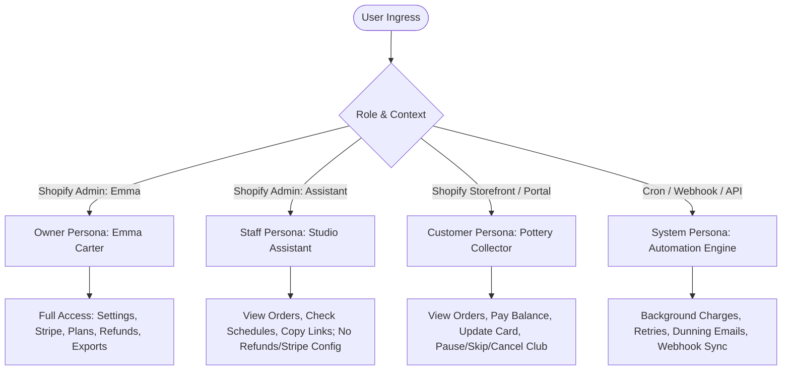
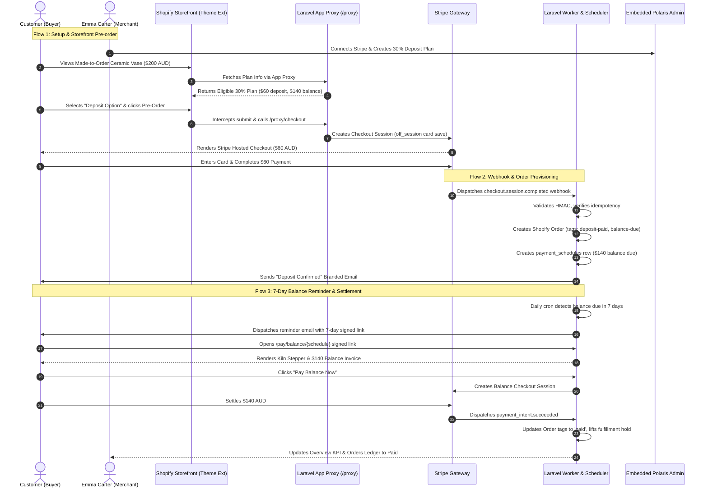
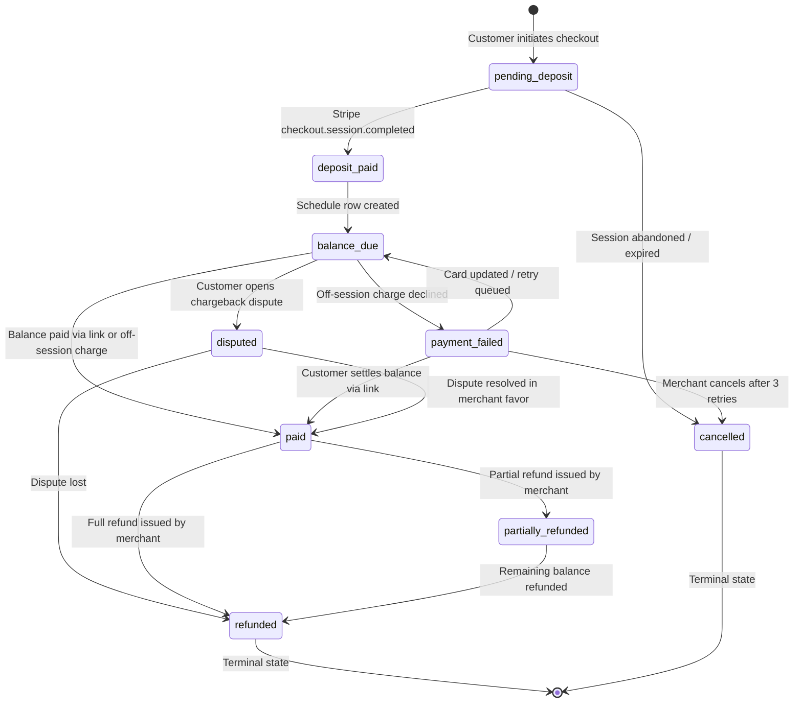

# Northwind Ceramics Payment App: Master Front-End UI/UX Specification & Requirements Document

> **Authoritative Specification & Complete Implementation Blueprint**  
> *Targeted for Full Front-End UI/UX Redesign across Merchant Admin, Storefront Extensions, Customer Portals, Settlement Pages, and Dunning Interfaces.*

---

## Table of Contents
1. [Executive Summary & Redesign Goals](#1-executive-summary--redesign-goals)
2. [Target Audiences, Personas & Permission Matrix](#2-target-audiences-personas--permission-matrix)
3. [Global Design System, Typography & Kinematic Rules](#3-global-design-system-typography--kinematic-rules)
4. [Complete Information Architecture & Screen Inventory](#4-complete-information-architecture--screen-inventory)
5. [Comprehensive Page-by-Page Requirements & Functionality](#5-comprehensive-page-by-page-requirements--functionality)
   - [5.1 Surface 1: Merchant Embedded Admin Shell](#51-surface-1-merchant-embedded-admin-shell)
     - [5.1.1 Overview & Financial KPI Dashboard (`#overview`)](#511-overview--financial-kpi-dashboard-overview)
     - [5.1.2 Payment Plans Manager (`#plans`)](#512-payment-plans-manager-plans)
     - [5.1.3 Plan Builder Slide-Over Drawer (`#nc-plan-drawer`)](#513-plan-builder-slide-over-drawer-nc-plan-drawer)
     - [5.1.4 Orders & Payment Ledger (`#orders`)](#514-orders--payment-ledger-orders)
     - [5.1.5 Order Schedule Inspector Slide-Over Drawer (`#nc-order-drawer`)](#515-order-schedule-inspector-slide-over-drawer-nc-order-drawer)
     - [5.1.6 Dual-System Refund Modal (`#refund-modal`)](#516-dual-system-refund-modal-refund-modal)
     - [5.1.7 Ceramic Club Subscriptions (`#subscriptions`)](#517-ceramic-club-subscriptions-subscriptions)
     - [5.1.8 Switch Subscription Tier Modal (`#modal-change-tier`)](#518-switch-subscription-tier-modal-modal-change-tier)
     - [5.1.9 Immutable Studio Audit Trail (`#audit`)](#519-immutable-studio-audit-trail-audit)
     - [5.1.10 Audit Event Metadata JSON Modal (`#modal-audit-json`)](#5110-audit-event-metadata-json-modal-modal-audit-json)
     - [5.1.11 Settings & Studio Gateways (`#settings`)](#5111-settings--studio-gateways-settings)
     - [5.1.12 Email Template Preview & Test Send Modal (`#modal-email-preview`)](#5112-email-template-preview--test-send-modal-modal-email-preview)
     - [5.1.13 Global Notification Toast Deck (`#nc-toast-stack`)](#5113-global-notification-toast-deck-nc-toast-stack)
   - [5.2 Surface 2: Storefront Theme App Extension](#52-surface-2-storefront-theme-app-extension)
     - [5.2.1 Product Detail Page (PDP) Deposit & Installment Widget](#521-product-detail-page-pdp-deposit--installment-widget)
     - [5.2.2 Checkout Interception & App Proxy Handoff](#522-checkout-interception--app-proxy-handoff)
   - [5.3 Surface 3: Customer Self-Service Account Portal](#53-surface-3-customer-self-service-account-portal)
     - [5.3.1 Magic Link Authentication & Entry Point](#531-magic-link-authentication--entry-point)
     - [5.3.2 Customer Portal Dashboard (`/portal/{customer}`)](#532-customer-portal-dashboard-portalcustomer)
     - [5.3.3 Customer Lifecycle Modals (Pause, Skip, Tier Switch, Cancel)](#533-customer-lifecycle-modals-pause-skip-tier-switch-cancel)
     - [5.3.4 Magic Link Expired Notice Page](#534-magic-link-expired-notice-page)
   - [5.4 Surface 4: Hosted Pre-Order Balance Settlement](#54-surface-4-hosted-pre-order-balance-settlement)
     - [5.4.1 Active Settlement Page with Kiln Stepper (`/pay/balance/{schedule}`)](#541-active-settlement-page-with-kiln-stepper-paybalanceschedule)
     - [5.4.2 Settlement State Variations (Fully Paid, Invalid/Expired)](#542-settlement-state-variations-fully-paid-invalidexpired)
   - [5.5 Surface 5: Hosted Card Update & Dunning Recovery](#55-surface-5-hosted-card-update--dunning-recovery)
     - [5.5.1 Secure Card Replacement Page (`/pay/card/update/{schedule}`)](#551-secure-card-replacement-page-paycardupdateschedule)
     - [5.5.2 Card Update Token Expired Page](#552-card-update-token-expired-page)
   - [5.6 Surface 6: Interactive Local Testing Hub](#56-surface-6-interactive-local-testing-hub)
     - [5.6.1 Multi-Flow Testing Hub & Live Simulator (`/demo`)](#561-multi-flow-testing-hub--live-simulator-demo)
6. [End-to-End User Flows & Interaction Journeys](#6-end-to-end-user-flows--interaction-journeys)
   - [Flow 1: Merchant Initial Installation, Onboarding & Gateway Setup](#flow-1-merchant-initial-installation-onboarding--gateway-setup)
   - [Flow 2: Payment Plan Creation with Real-Time Calculation](#flow-2-payment-plan-creation-with-real-time-calculation)
   - [Flow 3: Storefront Customer Pre-Order Purchase Journey (Option B)](#flow-3-storefront-customer-pre-order-purchase-journey-option-b)
   - [Flow 4: Automated Order Ingestion, Tagging & Metafield Sync](#flow-4-automated-order-ingestion-tagging--metafield-sync)
   - [Flow 5: Scheduled Balance Reminder & Settlement Journey](#flow-5-scheduled-balance-reminder--settlement-journey)
   - [Flow 6: Off-Session Installment Dunning & Self-Service Card Update](#flow-6-off-session-installment-dunning--self-service-card-update)
   - [Flow 7: Merchant Full & Partial Refund Execution](#flow-7-merchant-full--partial-refund-execution)
   - [Flow 8: Ceramic Club Recurring Membership & Self-Service Portal Management](#flow-8-ceramic-club-recurring-membership--self-service-portal-management)
   - [Flow 9: Chargeback & Dispute Incident Management](#flow-9-chargeback--dispute-incident-management)
   - [Flow 10: Financial Audit Review & Streaming CSV Ledger Export](#flow-10-financial-audit-review--streaming-csv-ledger-export)
7. [System State Machines & Status Transitions](#7-system-state-machines--status-transitions)
8. [Edge Cases, Error Handling & System Feedback Guidelines](#8-edge-cases-error-handling--system-feedback-guidelines)
9. [Accessibility, Performance & Compliance Mandates (WCAG 2.2 AA & PCI SAQ-A)](#9-accessibility-performance--compliance-mandates-wcag-22-aa--pci-saq-a)
10. [Frontend Redesign Technical Architecture Recommendations](#10-frontend-redesign-technical-architecture-recommendations)

---

## 1. Executive Summary & Redesign Goals

### 1.1 Product Context
Northwind Ceramics is an artisanal studio based in Melbourne & Byron Bay, Australia, founded by master ceramicist Emma Carter. The studio specializes in custom, wheel-thrown, made-to-order stoneware pottery. Production lead times range between **3 to 6 weeks** per kiln batch. 

Collecting 100% upfront payment for custom orders delivered over a month later creates substantial friction, drops checkout conversion rates, and increases customer anxiety. The **Northwind Ceramics Payment App** is a specialized Shopify application integrated with Stripe that powers:
1. **Upfront Pre-Order Deposits**: Charging a partial deposit (e.g. 30% or a fixed AUD fee) at checkout.
2. **Automated Scheduled Balance Payments**: Automatically billing or requesting remaining balances prior to kiln firing and courier dispatch.
3. **Split Installment Plans**: Enabling 2 to 4 split payments over bi-weekly or monthly cadences.
4. **Ceramic Club Recurring Subscriptions**: Monthly, quarterly, and annual ceramic memberships with self-service pause, skip, and tier switching.

### 1.2 Core Objectives of the Front-End Redesign
The current application successfully implements all backend financial workflows, Stripe webhooks, and App Bridge foundations. However, the front-end user experience requires a cohesive, modern redesign that elevates:
- **Artisan Aesthetic Elevation**: Infuse the UI with tactile, organic studio stoneware aesthetics (terracotta, raw clay, celadon glaze, warm paper) while adhering to Shopify Polaris standards.
- **Micro-Interaction Kinematics**: Implement Emil Kowalski-inspired tactile feedback, fluid slide-over sheets (drawers), physics-based modals, and shimmer loading states that eliminate Cumulative Layout Shift (CLS < 0.01).
- **Reduced Merchant Cognitive Load**: Provide Emma Carter with instant clarity over cash collected, balances owed, kiln batch due dates, and pending dunning actions without navigating complex menus.
- **Frictionless Customer Trust**: Reassure high-end pottery buyers with transparent production stage steppers, clear balance schedules, PCI SAQ-A secured card management, and instant passwordless portal access.
- **Unified Consistency**: Maintain complete visual and behavioral synergy across all 6 touchpoints: Shopify Admin Shell, Storefront PDP Extension, Customer Portal, Balance Payment Landing Page, Card Update Recovery Form, and Developer Testing Hub.

---

## 2. Target Audiences, Personas & Permission Matrix



### 2.1 Persona Specifications
1. **Merchant Owner (Emma Carter)**:
   - *Environment*: Embedded Shopify Admin iframe on Desktop (1440px iMac) and Mobile (Shopify Mobile App on iPhone).
   - *Needs*: High-level financial clarity (cash in bank vs pending balance for kiln clay purchases), rapid plan builder, frictionless dual-system refunds, and Stripe credential administration.
   - *Permissions*: Unrestricted (`role: 'owner'`). Can modify Stripe keys, delete plans, execute refunds, cancel memberships, and export tax CSVs.
2. **Merchant Staff (Studio Assistant)**:
   - *Environment*: Embedded Shopify Admin on iPad or Desktop.
   - *Needs*: Look up incoming orders to see if balance is cleared before packing a box, send manual balance reminders to customers who call the studio.
   - *Permissions*: Restricted (`role: 'staff'`). Blocked (HTTP 403) from issuing refunds, modifying Stripe API keys, and cancelling subscriptions.
3. **Customer / Ceramic Collector (Worldwide: AU, US, UK, EU)**:
   - *Environment*: Storefront PDP (Mobile Safari/Chrome 75% traffic), Email Clients (Apple Mail, Gmail), and Mobile Web.
   - *Needs*: Reassurance that deposit is safe, transparent billing schedule, easy one-click balance payment before piece ships, self-service subscription pause when traveling.
   - *Permissions*: Customer scope. Authenticates via signed URLs (magic links) with 15-minute or 7-day cryptographic validity.

---

## 3. Global Design System, Typography & Kinematic Rules

### 3.1 Color Palette & Token Hierarchy
The design system blends Shopify Polaris administrative clarity with an earthy, organic Australian Pottery aesthetic:

| Token Name | Hex Code | Semantic Role & Application |
|---|---|---|
| `--nc-clay-50` | `#FAF7F5` | Primary background, soft bisque paper warmth |
| `--nc-clay-100` | `#F3ECE7` | Card backgrounds, pill tabs, subtle dividers |
| `--nc-clay-200` | `#E6D8CE` | Border tokens, inactive inputs, container outlines |
| `--nc-clay-300` | `#CEB5A3` | Subtle hover borders, disabled state accents |
| `--nc-terracotta-500` | `#C46238` | Primary brand accent, primary CTA buttons, active state |
| `--nc-terracotta-600` | `#AB502B` | Hover state for primary buttons, active pressed links |
| `--nc-sage-500` | `#4A6B53` | Success indicator, captured deposit badge, positive metrics |
| `--nc-sage-100` | `#EBF2EC` | Success background, paid badge surface |
| `--nc-ochre-500` | `#B87C24` | Warning indicator, pending balance due, upcoming reminders |
| `--nc-ochre-100` | `#FBF4E8` | Warning surface, pending badge container |
| `--nc-charcoal-900` | `#1C1917` | Primary typography, deep studio stoneware dark tone |
| `--nc-charcoal-600` | `#57534E` | Secondary typography, metadata hints, labels |
| `--nc-red-500` | `#D32F2F` | Danger actions, refund buttons, failed payment flags |
| `--nc-red-100` | `#FDE8E8` | Danger banner backgrounds, error message surfaces |

### 3.2 Typography Rules
- **Editorial Headings**: `Playfair Display`, Georgia, serif (Weights: 500, 600, 700). Used exclusively for section titles, modal headers, order numbers, and KPI values to convey craftsmanship and bespoke art.
- **Interface & Data**: `Inter`, -apple-system, BlinkMacSystemFont, "Segoe UI", Roboto, sans-serif (Weights: 400, 500, 600, 700). Used for all data tables, inputs, buttons, navigation pills, and micro-copy.
- **Monospace Financials & Identifiers**: `ui-monospace`, SFMono-Regular, Menlo, Monaco, Consolas (Weights: 400, 600). Used for Shopify GIDs, Stripe `acct_` and `cs_` IDs, and currency amounts in logs.

### 3.3 Emil Kowalski Kinematics & Physics-Based Motion
All animated components must follow strict timing and bezier curves:
- **Drawer Slide-Over Curve**: `--ease-drawer: cubic-bezier(0.32, 0.72, 0, 1)` with 320ms duration. Gives right-edge sheets a physical, weighted snap.
- **Dialog Entrance**: Enter with `scale(0.96) translateY(8px) -> scale(1) translateY(0)` over 260ms with `backdrop-filter: blur(8px)`.
- **Tactile Button Press**: `:active { transform: scale(0.965); }` with 140ms ease-out. Provides tactile confirmation of tap/click.
- **Shimmer Skeletons**: CSS gradient animation (`linear-gradient(90deg, #F3ECE7 0%, #FFFFFF 50%, #F3ECE7 100%)` moving at 1.5s infinite) sized identically to loaded components to enforce zero layout shift (CLS < 0.01).

---

## 4. Complete Information Architecture & Screen Inventory

```
Surface 1: Merchant Embedded Admin Shell (Shopify App Bridge v4)
├── Tab 1: Overview & Financial KPIs (/ #overview)
├── Tab 2: Payment Plans Manager (/ #plans)
│   └── Off-Canvas Drawer: Plan Builder Sheet (#nc-plan-drawer)
├── Tab 3: Orders & Payment Ledger (/ #orders)
│   ├── Off-Canvas Drawer: Order Schedule Inspector (#nc-order-drawer)
│   └── Modal Dialog: Dual-System Refund Dialog (#refund-modal)
├── Tab 4: Ceramic Club Subscriptions (/ #subscriptions)
│   └── Modal Dialog: Switch Subscription Tier Dialog (#modal-change-tier)
├── Tab 5: Immutable Audit Trail (/ #audit)
│   └── Modal Dialog: Audit Event Metadata JSON Viewer (#modal-audit-json)
└── Tab 6: Settings & Gateways (/ #settings)
    └── Modal Dialog: Transactional Email Template Preview (#modal-email-preview)

Surface 2: Storefront Theme App Extension (Online Store 2.0)
├── App Block: Product Detail Page (PDP) Deposit Widget (deposit_widget.liquid)
└── App Proxy: Stripe-First Checkout Redirect Gateway (/apps/pay/checkout)

Surface 3: Customer Self-Service Portal (Signed Web App)
├── Entry: Magic Link Token Verification Handler (/portal/request-link & /portal/{customer})
├── Dashboard: Active Subscriptions & Pre-Order Orders List
├── Modal Dialog: Pause Deliveries Modal
├── Modal Dialog: Skip Next Cycle Modal
├── Modal Dialog: Switch Membership Tier Modal
├── Modal Dialog: Cancel Subscription Modal
└── Error View: Expired / Invalid Magic Link Fallback

Surface 4: Hosted Pre-Order Balance Settlement (Public Signed Landing)
├── Active View: Kiln Production Stepper, Order Breakdown & Pay Balance Button (/pay/balance/{schedule})
├── Paid State: Green Checkmark Settlement Confirmation
└── Expired State: Signed Route Invalid / Expired Warning

Surface 5: Hosted Card Update & Dunning Recovery (Stripe Elements)
├── Active View: Card Input Form with SetupIntent Authentication (/pay/card/update/{schedule})
└── Expired View: Expired Dunning Token Warning

Surface 6: Interactive Developer & Testing Hub (Local Simulator)
└── Single-Page Hub: Live Health Bar, Flow Grid & Interactive PDP Simulator (/demo)
```

---

## 5. Comprehensive Page-by-Page Requirements & Functionality

---

### 5.1 Surface 1: Merchant Embedded Admin Shell

#### 5.1.1 Overview & Financial KPI Dashboard (`#overview`)
- **Route / Anchor**: `/` (default active tab)
- **Target Persona**: Emma Carter (Owner) & Studio Assistant (Staff)
- **Primary Goal**: Deliver instantaneous situational awareness of studio cash flow, pre-order liabilities, and urgent payment failures.
- **Visual Structure**:
  1. **Top KPI Metrics Grid (4 Stat Cards)**:
     - *Captured Cash*: Displays total settled deposits and fully paid orders in AUD. Subtext: "Settled deposits & full balances". Sage green accent.
     - *Pending Balances*: Total outstanding customer balances for pottery currently in production. Subtext: "Due before kiln dispatch". Ochre yellow accent.
     - *Upcoming Charges*: Balances scheduled to be collected within the next 14 days. Subtext: "Due in the next 14 days". Terracotta accent.
     - *Failed / Attention*: Sum of declined off-session installment attempts requiring action. Red warning accent.
  2. **Studio Launch Checklist Card**:
     - *Item 1*: Install Embedded App (Shopify OAuth handshake & App Bridge v4 active). Badge: Completed (Green).
     - *Item 2*: Connect Stripe Studio Gateway. Dynamic status check: Completed or Pending button linking to Settings tab.
     - *Item 3*: Configure Deposit Plan. Status check: Completed or "+ Add Plan" button launching Plan Builder Drawer.
     - *Item 4*: Theme App Extension Block. Status badge indicating active proxy status.
     - *Overall Banner*: Changes from "Action Required" (Warning) to "Ready for Pre-orders" (Success).
  3. **Active System Architecture Card**:
     - Explains active Option B configuration (Stripe-First Checkout via App Proxy).
     - Details integer cents precision, PCI SAQ-A boundaries, and off-session dunning retry days (Days 1, 3, 5).
  4. **Quick Actions Panel**:
     - Buttons: `+ Create New Plan`, `View Orders Ledger`, `Stripe Gateway Settings`, `Export Transactions CSV`.
  5. **Studio Profile Card**:
     - Displays: Merchant Emma Carter, Studio Northwind Ceramics, Melbourne & Byron Bay, Connected Shop Domain, Active User Role.
- **API Endpoints Consumed**: `GET /api/overview`, `GET /api/dashboard`.

#### 5.1.2 Payment Plans Manager (`#plans`)
- **Route / Anchor**: `/#plans`
- **Target Persona**: Emma Carter (Owner), Studio Assistant (Staff - read only)
- **Primary Goal**: Centralized repository of all deposit, installment, and subscription plans applied across the ceramic catalog.
- **Visual Structure**:
  1. **Header Toolbar**: Title, descriptive copy, and `+ Create New Plan` primary button.
  2. **Alert Banner Container**: Slides in to display success or error messages (e.g., "Plan successfully created", "Target product not found").
  3. **Empty State Display**: Illustrated dashed container with a stoneware vase icon and call-to-action button when zero plans exist.
  4. **Plans Data Table (`.nc-table`)**:
     - *Column 1 - Plan Name*: Title with bold emphasis and internal ID hint.
     - *Column 2 - Type*: Badges for `Deposit Plan`, `Installment Plan`, or `Subscription`.
     - *Column 3 - Deposit / Terms*: e.g., "30%" or "$50.00 AUD upfront" or "3 splits (bi-weekly)".
     - *Column 4 - Target Scope*: Badges indicating `Shop-wide Default`, `3 Specific Products`, or `1 Collection`.
     - *Column 5 - Status*: Interactive Toggle Switch or Badge (`Active` in Sage Green vs `Inactive` in Charcoal Muted).
     - *Column 6 - Actions*: Edit button (opens drawer pre-populated), Delete button (triggers confirmation).
- **API Endpoints Consumed**: `GET /api/plans`, `DELETE /api/plans/{id}`, `PUT /api/plans/{id}`.

#### 5.1.3 Plan Builder Slide-Over Drawer (`#nc-plan-drawer`)
- **Container Type**: Off-Canvas Right-Edge Sheet (`.nc-drawer-container`) with physical spring easing.
- **Trigger**: Click `+ Create New Plan` or click `Edit` on any existing plan row.
- **Controls & Form Elements**:
  - `plan-edit-id`: Hidden input to determine Create vs Update mode.
  - `plan-name-input`: Text input. Placeholder: "e.g. 30% Made-to-Order Ceramic Deposit". Required.
  - `plan-type-select`: Dropdown options:
    1. *Deposit Pre-order Plan* (Upfront deposit + balance before shipping).
    2. *Installment Split Plan* (2–4 equal off-session charges).
  - *Conditional Section A: Deposit Configuration*:
    - `plan-deposit-type`: Dropdown (`percentage` vs `fixed`).
    - `plan-deposit-value`: Number input (e.g. `30` for 30%, or `5000` for $50.00 AUD).
  - *Conditional Section B: Installment Configuration*:
    - `plan-installments-count`: Dropdown (`2`, `3`, `4` split payments).
    - `plan-installment-frequency`: Dropdown (`1_week`, `2_week`, `1_month`).
  - *Interactive Live Calculation Preview*:
    - Dynamically evaluates formulas against a sample $200.00 AUD stoneware vase as the user types.
    - Shows exact upfront charge (e.g. $60.00 AUD) and balance due (e.g. $140.00 AUD), proving zero penny leakage.
  - `plan-product-targets`: Text input for comma-separated Shopify product GIDs (`gid://shopify/Product/1001`).
  - `plan-collection-targets`: Text input for collection GIDs (`gid://shopify/Collection/5001`).
  - `plan-active-input`: Toggle checkbox for storefront eligibility.
  - *Drawer Footer*: Secondary `Cancel` button, Primary `Save Plan` button.
- **API Endpoints Consumed**: `POST /api/plans/preview`, `POST /api/plans`, `PUT /api/plans/{id}`.

#### 5.1.4 Orders & Payment Ledger (`#orders`)
- **Route / Anchor**: `/#orders`
- **Target Persona**: Emma Carter (Owner) & Studio Assistant (Staff)
- **Primary Goal**: Track every ceramic piece through the 7-state payment lifecycle, monitor balance due dates, and initiate balance recovery.
- **Visual Structure**:
  1. **Header Action Bar**: Export CSV button and Refresh button.
  2. **Filter & Search Toolbar**:
     - Status Pills (Single select): `All Orders`, `Deposit Paid`, `Balance Due`, `Paid in Full`, `Payment Failed`, `Refunded`.
     - Debounced Search Input (300ms debounce): Search by Shopify Order # or Customer Email.
  3. **Orders Table**:
     - *Column 1 - Order*: e.g., `#1001` with created date.
     - *Column 2 - Customer*: Email address and customer name.
     - *Column 3 - Status*: Color-coded status badge (`badge-paid`, `badge-pending`, `badge-failed`, `badge-refunded`).
     - *Column 4 - Total Value*: Formatted currency (e.g. `$320.00 AUD`).
     - *Column 5 - Paid Deposit*: Formatted captured funds (e.g. `$96.00 AUD`).
     - *Column 6 - Balance Due*: Remaining balance (e.g. `$224.00 AUD`).
     - *Column 7 - Actions*:
       - `Inspect`: Launches the Order Schedule Inspector Drawer.
       - `Copy Link`: Copies the signed balance payment link to clipboard.
       - `Refund`: (Owner only) Opens the Refund Modal.
  4. **Pagination Bar**: Previous / Next controls with page count label (`Showing orders 1 to 10 of 42`).
- **API Endpoints Consumed**: `GET /api/orders?page={n}&status={s}&search={q}`.

#### 5.1.5 Order Schedule Inspector Slide-Over Drawer (`#nc-order-drawer`)
- **Container Type**: Off-Canvas Right-Edge Sheet (`.nc-drawer-container`).
- **Trigger**: Click `Inspect` or order row on the Orders Table.
- **Contents & Visual Breakdown**:
  1. **Header**: Status badge, order number, and close button.
  2. **Financial Summary Card (3-Column Grid)**:
     - Total Order Value, Captured Deposit, Remaining Balance.
  3. **Customer Metadata**: Email, Shopify Customer ID, and Stripe Customer Reference (`cus_...`).
  4. **Payment Progression Timeline (`.nc-timeline`)**:
     - Visual step-by-step tree indicating:
       - Initial Deposit: Amount, payment method (`Visa •••• 4242`), status, and timestamp.
       - Scheduled Balance / Installment(s): Scheduled due date, amount, retry attempts, and payment link status.
  5. **Stripe Transactions Card**: Lists every Stripe PaymentIntent or Charge ID (`pi_...`), amount, status, and fee.
  6. **Customer Notifications Log**: History of transactional emails dispatched (`order_deposit_confirmed`, `order_balance_reminder`) with timestamps.
  7. **Drawer Footer Actions**:
     - `Copy Payment Link`: Generates/copies active cryptographic 7-day signed balance link.
     - `Refund Order`: (Owner only) Launches Refund Modal.

#### 5.1.6 Dual-System Refund Modal (`#refund-modal`)
- **Container Type**: Accessible Centered Dialog with Backdrop Blur (`backdrop-filter: blur(8px)`).
- **Trigger**: Click `Refund Order` in Order Inspector or Orders Table (Owner role enforced).
- **Security Check**: Staff accounts see button disabled with tooltip: "Refunds restricted to Studio Owner".
- **Modal Fields & Validation**:
  - *Summary Card*: Displays Order #, Customer, Captured via Stripe, Previously Refunded, and Maximum Allowable Refund.
  - `refund-amount-cents`: Number input in integer cents ($1.00 AUD = 100). Validates that `amount <= max_refundable`.
  - `refund-reason`: Select dropdown:
    1. *Customer Pre-Order Cancellation*
    2. *Studio Material / Kiln Breakage*
    3. *Accidental Duplicate Order*
    4. *Other Studio Reason*
  - *Automated Logic*: Notice stating that full refunds will automatically cancel all pending balance payment schedules.
  - *Footer Buttons*: `Cancel` (Dismiss), `Confirm & Process Refund` (Red Danger CTA).
- **API Endpoints Consumed**: `POST /api/orders/{id}/refund`.

#### 5.1.7 Ceramic Club Subscriptions (`#subscriptions`)
- **Route / Anchor**: `/#subscriptions`
- **Target Persona**: Emma Carter (Owner)
- **Primary Goal**: Manage recurring monthly/quarterly clay club deliveries, monitor MRR, and handle member lifecycle.
- **Visual Structure**:
  1. **Subscriptions KPI Grid**:
     - *Active Members*: Total count of active monthly subscribers.
     - *Monthly Recurring Revenue (MRR)*: Total estimated monthly subscription revenue in AUD.
     - *Paused Memberships*: Count of members temporarily on delivery hold.
  2. **Membership Roster Table**:
     - *Column 1 - Customer*: Email and membership start date.
     - *Column 2 - Membership Plan*: e.g., "Monthly Stoneware Studio Club".
     - *Column 3 - Cadence & Price*: e.g., "$65.00 AUD / month".
     - *Column 4 - Status*: Badges (`Active`, `Paused`, `Past Due`, `Cancelled`).
     - *Column 5 - Next Renewal*: Date of next scheduled Stripe invoice billing.
     - *Column 6 - Actions*:
       - `Pause` / `Resume`: Toggle delivery pause.
       - `Skip Next`: Skips one billing cycle.
       - `Switch Tier`: Launches Switch Subscription Tier Modal.
       - `Cancel`: (Owner only) Terminate membership.
- **API Endpoints Consumed**: `GET /api/subscriptions`.

#### 5.1.8 Switch Subscription Tier Modal (`#modal-change-tier`)
- **Container Type**: Accessible Centered Dialog.
- **Trigger**: Click `Switch Tier` on any active subscription in the Subscriptions table.
- **Controls**:
  - `change-tier-current-name`: Readonly display of the member's existing plan.
  - `change-tier-plan-select`: Dropdown of alternate available Ceramic Club plans.
  - *Proration Notice*: Informs merchant that Stripe will calculate immediate proration credits or charges.
  - *Footer*: `Cancel`, `Update Membership Tier` (Primary CTA).
- **API Endpoints Consumed**: `POST /api/subscriptions/{id}/change-tier`.

#### 5.1.9 Immutable Studio Audit Trail (`#audit`)
- **Route / Anchor**: `/#audit`
- **Target Persona**: Emma Carter (Owner)
- **Primary Goal**: Provide tamper-evident accountability for all financial mutations, refunds, plan adjustments, and Stripe credential updates.
- **Visual Structure**:
  1. **Toolbar**: Actor filter dropdown (`All Actors`, `Emma Carter (Merchant)`, `Background System`, `Stripe Webhooks`) and Refresh button.
  2. **Audit Ledger Table**:
     - *Column 1 - Timestamp*: UTC formatted timestamp (`YYYY-MM-DD HH:mm:ss`).
     - *Column 2 - Action Performed*: e.g., `order.refund`, `plan.created`, `stripe.connected`.
     - *Column 3 - Target Model*: Entity type and ID (`Order #1001`, `Plan #4`).
     - *Column 4 - Actor*: User name or `System Automation`.
     - *Column 5 - Origin*: IP address and user-agent details.
     - *Column 6 - Metadata*: `View JSON` button.
- **API Endpoints Consumed**: `GET /api/audit-logs?actor={a}`.

#### 5.1.10 Audit Event Metadata JSON Modal (`#modal-audit-json`)
- **Container Type**: Accessible Centered Dialog.
- **Trigger**: Click `View JSON` on any audit log row.
- **Contents**: Formatted, syntax-highlighted code block displaying before/after state diffs, Stripe event IDs, and transaction payloads.

#### 5.1.11 Settings & Studio Gateways (`#settings`)
- **Route / Anchor**: `/#settings`
- **Target Persona**: Emma Carter (Owner - full permissions), Staff (read-only)
- **Primary Goal**: Configure payment infrastructure, manage transactional emails, and review security standards.
- **Visual Structure**:
  1. **Stripe Studio Payment Gateway Card**:
     - Status Badge: `Gateway Online & Encrypted` (Sage Green) vs `Disconnected` (Ochre).
     - Connected Summary Box: Shows connected account ID (`acct_...`), masked publishable key (`pk_test_...`), and encrypted secret key notification.
     - Connection Form:
       - `stripe-publishable-key`: Text input (`pk_test_...` or `pk_live_...`).
       - `stripe-secret-key`: Password input (`sk_test_...` or `sk_live_...`).
       - Buttons: `Save & Verify Credentials` (Owner only), `Disconnect Gateway` (Danger CTA).
  2. **Transactional Customer Email Templates Card**:
     - Table of templates:
       - `order_deposit_confirmed` (Sent immediately after deposit checkout).
       - `order_balance_reminder` (Sent 7 days prior to kiln dispatch).
       - `card_update_requested` (Sent when an off-session charge is declined).
     - Actions: `Preview & Test` button per row.
  3. **Security & PCI DSS Compliance Card**:
     - Detailed overview of SAQ-A scope, AES-256-GCM encryption, Redis webhook idempotency mutexes, and role gating.
- **API Endpoints Consumed**: `GET /api/stripe/status`, `POST /api/stripe/connect`, `POST /api/stripe/disconnect`, `GET /api/email-templates`.

#### 5.1.12 Email Template Preview & Test Send Modal (`#modal-email-preview`)
- **Container Type**: Wide Centered Dialog (max-width 720px).
- **Trigger**: Click `Preview & Test` on any email template row.
- **Controls**:
  - Template Key Badge & Subject Line input (Readonly).
  - Live Rendered HTML Frame: Renders the responsive studio email with ceramic branding, pottery graphic, and dynamic placeholders substituted.
  - `email-test-recipient`: Email input with pre-filled default `emma@northwindceramics.com.au`.
  - `Send Test` Button: Dispatches immediate test email through Postmark/SES.
- **API Endpoints Consumed**: `POST /api/email-templates/{key}/preview`, `POST /api/email-templates/{key}/test-send`.

#### 5.1.13 Global Notification Toast Deck (`#nc-toast-stack`)
- **Container Type**: Fixed Floating Container (Bottom Right, 24px inset, z-index 9999).
- **Behavior**: Non-blocking stacked notifications. Slide up with ease-out, display icon (Success, Warning, Error), message text, and automatically dismiss after 4000ms. Pause countdown on hover.

---

### 5.2 Surface 2: Storefront Theme App Extension

#### 5.2.1 Product Detail Page (PDP) Deposit & Installment Widget
- **File Assets**: `deposit_widget.liquid`, `deposit-widget.css`, `deposit-widget.js`.
- **Placement**: Online Store 2.0 App Block placed immediately above or below the native theme "Add to Cart" / "Buy Now" button.
- **Execution Constraints**: Lightweight (< 15 KB vanilla JS), zero dependencies, < 50ms execution, zero layout shift (CLS < 0.02).
- **Visual Components**:
  1. **Lead Time Studio Badge**:
     - Display: `⛏ Handmade: 3–6 weeks kiln lead time`. Bisque background with terracotta icon.
  2. **Payment Mode Radio Selection Group**:
     - *Option 1: Pay in Full*: Radio button, title "Pay in Full", full product price (e.g. `$200.00 AUD`), subtext "Standard order fulfillment".
     - *Option 2: Pay Pre-order Deposit (or Installments)*: Radio button (Selected by default), title e.g. "Pay Pre-order Deposit (30%)", price "Pay $60.00 AUD today", subtext "Balance due when ready to ship".
  3. **Visual Breakdown Card**:
     - If Deposit Plan: 2-column breakdown showing `Due Today (Deposit): $60.00 AUD` vs `Due Prior to Dispatch: $140.00 AUD`.
     - If Installment Plan: Vertical schedule list showing `Payment 1 (Today): $66.67 AUD`, `Payment 2 (In 2 weeks): $66.67 AUD`, `Payment 3 (In 4 weeks): $66.66 AUD`.
  4. **Policy & Terms Micro-Copy**:
     - "Deposits are non-refundable once making begins. Remaining balance billed via secure payment link prior to shipping."

#### 5.2.2 Checkout Interception & App Proxy Handoff
- **DOM Event**: Intercepts `submit` event of the surrounding `form[action*="/cart/add"]` when the Deposit or Installment radio is selected.
- **Action**: Suppresses standard Shopify cart redirect and forwards customer to the App Proxy checkout endpoint:
  ```
  GET /apps/pay/checkout?shop={shop}&product_id={id}&variant_id={variant}&plan_id={plan}&quantity={qty}&price={cents}&currency={iso}
  ```
- **Backend Response**: App Proxy controller creates a Stripe Checkout session with `setup_future_usage: 'off_session'` and redirects customer directly to Stripe's hosted checkout in AUD.

---

### 5.3 Surface 3: Customer Self-Service Account Portal

#### 5.3.1 Magic Link Authentication & Entry Point
- **Route**: `POST /portal/request-link` -> Delivers signed magic link to customer email.
- **Authentication**: Cryptographically signed URL with 15-minute expiry: `/portal/{customer}?signature=...`.
- **Security**: Rate-limited to 10 requests per minute with constant-time response (enumeration defense).

#### 5.3.2 Customer Portal Dashboard (`/portal/{customer}`)
- **Visual Container**: Clean, responsive layout (max-width 780px) on bisque background (`#FAF7F5`).
- **Header**: "Handmade in Australia" pill badge, greeting "Welcome, {customer.email}", subtitle explaining pre-orders and Ceramic Club deliveries.
- **Card 1: Ceramic Club Subscriptions**:
  - Membership title and status badge (`Active`, `Paused`, `Cancelled`).
  - Monthly investment cost and Next Kiln Renewal date.
  - Interactive Action Buttons:
    - `Pause Deliveries` (Opens Pause Modal).
    - `Skip Next Month` (Opens Skip Modal).
    - `Switch Membership Tier` (Opens Tier Modal).
    - `Resume Deliveries` (Direct form submit if paused).
    - `Cancel` (Opens Cancel Modal).
- **Card 2: Orders & Payment Schedules**:
  - List of historical pottery orders with Order # and total value.
  - Captured deposit amount and status badge (`Deposit Paid`, `Balance Due`, `Paid`).
  - Contextual CTA: If balance is pending, displays prominent terracotta button: `Pay Remaining Balance ($140.00 AUD)` linking directly to the Balance Settlement Page.

#### 5.3.3 Customer Lifecycle Modals
1. **Pause Deliveries Modal**: Select pause duration (1 or 2 months) with reassurance that membership standing is preserved.
2. **Skip Next Cycle Modal**: Explains that upcoming cycle will not be billed, resuming automatically the following month.
3. **Switch Membership Tier Modal**: Select new ceramic box tier with notice that Stripe will compute immediate prorations.
4. **Cancel Membership Modal**: Destructive confirmation modal warning the member of batch allocation forfeiture.

#### 5.3.4 Magic Link Expired Notice Page
- **Template**: `resources/views/customer/portal_expired.blade.php`.
- **Message**: "This secure access link has expired or has already been used. Please request a fresh magic link to manage your pottery pre-orders." Form to resend link.

---

### 5.4 Surface 4: Hosted Pre-Order Balance Settlement

#### 5.4.1 Active Settlement Page with Kiln Stepper (`/pay/balance/{schedule}`)
- **Security**: 7-day cryptographically signed route (`URL::signedRoute`).
- **Visual Container**: Elegant card (max-width 520px) centered vertically on viewport.
- **Header**: Studio badge "Northwind Ceramics • Studio Melbourne", serif title "Handmade Pre-order Settlement".
- **Kiln Production Progress Stepper**:
  - Horizontal timeline illustrating the ceramic journey:
    `✓ 30% Deposit` → `✓ Wheel Thrown` → `✓ Glazed` → `● Final Balance` → `Courier Dispatch`.
- **Balance Notice Card**: Status badge `Kiln Ready • Balance Due` with due date.
- **Financial Breakdown Table**:
  - Order Reference: `#1001`
  - Total Order Value: `$200.00 AUD`
  - Deposit Captured Upfront: `-$60.00 AUD` (Sage green)
  - Remaining Balance Due: `$140.00 AUD` (Prominent terracotta serif font)
- **Primary CTA**: Full-width button: `Pay Balance Now ($140.00 AUD)`.
  - Submits POST to `/pay/balance/{schedule}/checkout`, creating a hosted Stripe Checkout session.
- **Security Footer**: "Direct 256-bit SSL encrypted checkout powered by Stripe. Handmade in Melbourne & Byron Bay."

#### 5.4.2 Settlement State Variations
- **State A - Fully Paid**: If accessed after payment, the card transforms into a serene sage green success state: "Balance Settled in Full — Your ceramic piece has been paid in full and is currently being packaged with sustainable studio materials for courier dispatch."
- **State B - Invalid / Expired Link**: Displays an amber warning card: "This balance settlement link is invalid or expired. Please contact Emma Carter at Northwind Ceramics."

---

### 5.5 Surface 5: Hosted Card Update & Dunning Recovery

#### 5.5.1 Secure Card Replacement Page (`/pay/card/update/{schedule}`)
- **Trigger**: Dispatched automatically via email when an off-session installment charge fails.
- **Visual Structure**:
  - Title: "Update Your Payment Card".
  - Contextual Note: "Please enter your updated card details below for your upcoming stoneware installment of **$66.67 AUD**."
  - **Stripe Elements Mount**:
    - Animated skeleton placeholder (`.skeleton-input`) that shimmers until Stripe JS finishes loading, preventing layout shift.
    - Stripe Card Element with custom typography matching the studio aesthetic.
    - Inline error container `#card-errors`.
  - Primary Button: `Update Card & Authorize Payment`.
    - Disables and displays spinner during processing.
    - Submits card token to Stripe `confirmSetup` via SetupIntent (`usage: 'off_session'`).
  - Success State: In-place transition to a sage green confirmation banner: "Card updated successfully! Your upcoming installment will be processed automatically."

#### 5.5.2 Card Update Token Expired Page
- **Template**: `resources/views/customer/card_update_expired.blade.php`.
- **Alert**: Explains that the card update window has passed and provides contact info for studio assistance.

---

### 5.6 Surface 6: Interactive Local Testing Hub

#### 5.6.1 Multi-Flow Testing Hub & Live Simulator (`/demo`)
- **Route**: `GET /demo`
- **Primary Goal**: Developer and stakeholder inspection cockpit linking to all 4 end-to-end user flows in local dev mode.
- **Components**:
  1. **Top Status Bar**: Live indicators for Docker stack, PostgreSQL order count, and automated test suite status.
  2. **Flow Cards Grid**:
     - *Card 1*: Merchant Admin Shell (Direct link with bypass session token).
     - *Card 2*: Storefront Pre-Order Widget Simulator.
     - *Card 3*: Customer Account Portal (Signed route link for sample customer Clara Bow).
     - *Card 4*: Balance Settlement & Card Update shortcuts.
  3. **Embedded PDP Simulator**:
     - Interactive simulation of a made-to-order Speckled Stoneware Vase ($150.00 AUD).
     - Live toggling between "Pay in Full" and "30% Pre-Order Deposit" ($45.00 today).
     - Live simulation button testing App Proxy handoff.
  4. **Developer Terminal Shortcuts Box**: PowerShell and Bash commands for Stripe webhook listening and test runners.

---

## 6. End-to-End User Flows & Interaction Journeys



### Flow 1: Merchant Initial Installation, Onboarding & Gateway Setup
1. **App Installation**: Emma Carter clicks "Install" from the Shopify App Store or custom URL. The system redirects to `/auth/install`, validates shop domain, and executes OAuth token exchange at `/auth/callback`. Access tokens are stored with AES-256-GCM encryption.
2. **Admin Entry**: App opens in Shopify Admin iframe. App Bridge v4 verifies session token.
3. **Checklist Review**: Emma lands on the Overview Dashboard. Step 1 is checked green. Step 2 ("Connect Stripe Studio Gateway") prompts action.
4. **Credential Setup**: Emma clicks "Settings", enters Stripe Publishable Key and Secret Key, and clicks "Save & Verify". The system performs a live `/v1/account` verification handshake, masks the keys, and updates status to green.

### Flow 2: Payment Plan Creation with Real-Time Calculation
1. **Trigger**: Emma clicks `+ Create New Plan` on the Dashboard or Plans tab.
2. **Drawer Slide-In**: The Plan Builder Sheet smoothly slides in from the right edge (`--ease-drawer`).
3. **Configuration**: Emma names the plan "30% Made-to-Order Kiln Deposit", keeps Type as `deposit`, chooses `percentage`, and enters `30`.
4. **Live Validation**: As she types, the Live Calculation Card dynamically updates on a sample $200.00 vase, verifying $60.00 deposit and $140.00 balance with zero rounding error.
5. **Target Assignment**: Emma specifies collection GIDs or leaves blank for shop-wide catalog targeting.
6. **Persistence**: Clicking "Save Plan" saves records to `plans` and `plan_targets`, closes drawer, and shows a success toast.

### Flow 3: Storefront Customer Pre-Order Purchase Journey (Option B)
1. **PDP Load**: Customer views a $150.00 AUD handmade ceramic bowl. The Liquid block renders an invisible container.
2. **Client Hydration**: `deposit-widget.js` queries `/apps/pay/plan-info`. Finding an active plan, it hydrates the widget in < 50ms without layout shift.
3. **Selection**: Customer reviews lead time ("3–6 weeks"), compares "Pay in Full" vs "Pay Pre-order Deposit (30% - $45.00 today)", and selects Deposit.
4. **Form Intercept**: Clicking "Pre-Order" intercepts the cart form and redirects to `/apps/pay/checkout`.
5. **Stripe Checkout**: The customer completes payment of $45.00 AUD on Stripe's hosted checkout, saving their card off-session.

### Flow 4: Automated Order Ingestion, Tagging & Metafield Sync
1. **Webhook Ingestion**: Stripe sends `checkout.session.completed` to `/webhooks/stripe`.
2. **Sub-Second Ack**: The endpoint validates the cryptographic signing secret, writes the payload to `webhook_events`, and returns HTTP 200 within 50ms.
3. **Worker Processing**: `ProcessStripeWebhookJob` runs in background:
   - Provisions Shopify order via GraphQL with financial status `PARTIALLY_PAID`.
   - Tags order `deposit-paid` and `balance-due`.
   - Sets Shopify metafield `northwind_deposit.balance_due_date`.
   - Inserts row into `payment_schedules` with status `pending`.
   - Sends customer a branded "Deposit Received" receipt.

### Flow 5: Scheduled Balance Reminder & Settlement Journey
1. **Scheduler Scan**: Daily at 08:00 UTC, `app:send-balance-reminders` evaluates `payment_schedules` due in exactly 7 days.
2. **Reminder Dispatch**: Dispatches email containing a cryptographically signed link to `/pay/balance/{schedule}`.
3. **Customer Review**: Customer clicks link. The page displays the studio ceramic production stepper ("Wheel Thrown" → "Glazed" → "Final Balance") and order balance of $105.00 AUD.
4. **Settlement**: Customer clicks "Pay Balance Now", pays via Stripe Checkout, and webhook moves schedule to `succeeded` and order to `paid`. Order tags update to `paid` and fulfillment hold warning is cleared.

### Flow 6: Off-Session Installment Dunning & Self-Service Card Update
1. **Automated Billing**: On installment due date, `app:process-due-schedules` attempts an off-session charge using the customer's saved payment method.
2. **Decline Handling**: Card is declined (e.g. expired). Order transitions to `payment_failed`.
3. **Dunning Schedule**: The runner queues retries for Day 1, Day 3, and Day 5.
4. **Customer Card Update Link**: Customer receives an urgent notification with a signed link to `/pay/card/update/{schedule}`.
5. **Elements Recovery**: Customer enters new card details into Stripe Elements. Stripe SetupIntent confirms and attaches new card as default. Order status restores to good standing.

### Flow 7: Merchant Full & Partial Refund Execution
1. **Initiation**: Emma inspects an order in the Polaris admin shell and clicks "Refund Order".
2. **Modal Check**: The Refund Modal validates maximum allowable refund (captured amount minus previous refunds).
3. **Execution**: Emma inputs refund amount (e.g. 5000 cents for $50.00 AUD) and selects reason "Studio Material / Kiln Breakage".
4. **Dual-System API Call**: Backend calls Stripe Refund API, then calls Shopify GraphQL Refund API, updating database balances and creating an immutable entry in `audit_logs`.

### Flow 8: Ceramic Club Recurring Membership & Self-Service Portal Management
1. **Subscription Inception**: Customer subscribes to monthly Ceramic Club ($65.00 AUD/mo).
2. **Recurring Order Creation**: Stripe bills monthly. On `invoice.payment_succeeded`, webhook creates a fulfillment order in Shopify.
3. **Portal Ingress**: Customer requests portal link via `/portal/request-link` and clicks magic link.
4. **Lifecycle Control**: From the portal, the customer can:
   - *Pause*: Select 1 or 2 months pause period.
   - *Skip*: Skip the upcoming month.
   - *Switch Tier*: Upgrade to Bi-Monthly Stoneware Box with automatic Stripe prorations.
   - *Cancel*: Terminate membership.

### Flow 9: Chargeback & Dispute Incident Management
1. **Webhook Detection**: Customer disputes a deposit with their bank. Stripe fires `charge.dispute.created`.
2. **Order Tagging**: System marks order status `disputed` and tags Shopify order `dispute-opened`.
3. **Dashboard Banner**: Emma receives a high-priority warning banner in the Polaris Overview tab with a direct link to Stripe dispute evidence submission.

### Flow 10: Financial Audit Review & Streaming CSV Ledger Export
1. **Export Request**: Emma filters orders by date or clicks "Export Transactions CSV".
2. **Streaming Execution**: Backend executes memory-bounded streaming query (`fputcsv` chunked by 250 records) bypassing PHP memory limits.
3. **Download**: Emma receives complete bookkeeping CSV formatted for Xero/MYOB accounting.

---

## 7. System State Machines & Status Transitions

### 7.1 Order Payment Lifecycle State Machine



### 7.2 Subscription Status Lifecycle
- `active`: Normal active billing. Invoices generate monthly fulfillment orders.
- `paused`: Temporarily held. Has `paused_until` date. Renewal attempts suspended.
- `skipped`: One renewal cycle skipped. Resumes automatically next month.
- `cancelled`: Terminated. Stripe subscription canceled at period end.
- `past_due`: Renewal invoice failed. Enters Stripe dunning retry cycle.

---

## 8. Edge Cases, Error Handling & System Feedback Guidelines

| Scenario / Edge Case | Failure Mode | Front-End UI Handling & Recovery Action |
|---|---|---|
| **Expired Magic Link** | Customer clicks link > 15 mins after request. | Display dedicated `portal_expired.blade.php` with warm ceramic styling and instant email re-request form. |
| **Expired Balance Link** | Customer opens balance link > 7 days after issue. | Display amber warning card with button to request refreshed link from Emma. |
| **Balance Already Paid** | Customer clicks balance link after order is settled. | Display soothing sage green banner: "Balance Settled in Full — piece in kiln packaging". |
| **Zero Penny Leakage** | Odd division on 3 split payments ($100 / 3). | Engine splits into $33.34, $33.33, $33.33. Widget guarantees upfront sum equals total. |
| **Double Webhook Delivery** | Stripe fires duplicate event simultaneously. | Database unique key on `external_id` deduplicates; UI receives consistent status without flicker. |
| **Staff Role Refund Attempt** | Studio assistant attempts refund. | Refund button disabled with tooltip. API returns 403 Forbidden with Polaris toast alert. |
| **Stripe Elements Mount Delay** | Slow network loading `js.stripe.com`. | Skeleton shimmer placeholder keeps exact 44px input height; zero layout shift. |
| **High Latency Search** | Rapid typing in Orders Search. | 300ms debounce prevents API flood; shimmer skeleton displays during data fetch. |

---

## 9. Accessibility, Performance & Compliance Mandates

### 9.1 WCAG 2.2 AA Accessibility Standards
- **Color Contrast**: All normal text must achieve at least **4.5:1** contrast against backgrounds. Large text and badges must achieve at least **3.0:1** (e.g. Ochre text `#784C07` on `#FBF4E8` = 6.94:1).
- **Touch Target Sizes**: All interactive buttons, tabs, drawer toggles, and modal dismiss triggers must be at least **44 × 44 CSS pixels** on mobile viewports.
- **Keyboard Navigation & Focus Management**:
  - All modals and drawers must trap focus using `window.dialogManager`.
  - Pressing `Escape` must close the top active modal or drawer.
  - While open, background layout must receive the `inert` attribute.
  - Active focus indicators must display an explicit offset 2px ring (`box-shadow: 0 0 0 2px #C46238`).

### 9.2 Performance Standards
- **Storefront JavaScript Footprint**: `< 15 KB` minified, zero third-party dependencies, `< 50ms` execution.
- **Cumulative Layout Shift (CLS)**: `< 0.01` across all pages via pre-sized shimmer skeleton loaders.
- **Dashboard Response Time**: Page loads under `2.0 seconds` for up to 10,000 orders using indexed database queries.

### 9.3 Security & Compliance (PCI DSS SAQ-A & GDPR)
- **Zero Cardholder Data Storage**: No raw Primary Account Numbers (PAN) or Card Verification Values (CVV) ever enter application memory or database tables. All card capture is handled exclusively by Stripe Elements or Stripe Hosted Checkout (PCI SAQ-A scope).
- **Secrets Encryption**: Shopify offline access tokens and Stripe restricted API keys are encrypted at rest using AES-256-GCM.
- **GDPR / Privacy Webhooks**: Customer redaction requests anonymize PII (`redacted_{id}@privacy.local`) while preserving financial ledgers for 5-year Australian Tax Office (ATO) statutory compliance.

---

## 10. Frontend Redesign Technical Architecture Recommendations

### 10.1 Component Architecture Options
When executing this comprehensive front-end redesign, two architectural paths are supported:

1. **Option A: Modular Server-Rendered Blade with Modern Micro-Interactions (Recommended / Current Stack)**:
   - *Strengths*: Extremely lightweight, zero build-step bundle bloat, direct integration with Shopify App Bridge v4, lightning-fast first contentful paint (FCP < 300ms).
   - *Structure*: Maintain modular partials under `resources/views/partials/admin/` (`styles`, `nav`, `drawers`, `modals`, `views/*`, `components/*`).
   - *Enhancements*: Use lightweight reactive libraries (Alpine.js v3 or Petite-Vue) to replace raw vanilla DOM manipulation in `scripts.blade.php`.

2. **Option B: Decoupled React / Polaris SPA**:
   - *Strengths*: Full native alignment with Shopify Polaris React component library (`@shopify/polaris`) and App Bridge React hooks.
   - *Structure*: Scaffold a Vite + React application inside `resources/js`, serving as a Single Page Application communicating with `/api/*` endpoints.

### 10.2 Definition of Done (DoD) Checklist for Front-End Redesign
Every rewritten page or component must satisfy:
- [ ] 100% compliant with the Australian Artisan Stoneware design tokens.
- [ ] Responsive across Desktop (1440px), Tablet (768px), and Mobile (375px).
- [ ] WCAG 2.2 AA verified with zero contrast or keyboard trapping regressions.
- [ ] Emil Kowalski micro-interactions applied to buttons, modals, and drawers.
- [ ] Zero layout shift guaranteed via matching shimmer skeleton placeholders.
- [ ] Full integration test coverage passing green (`php artisan test`).
